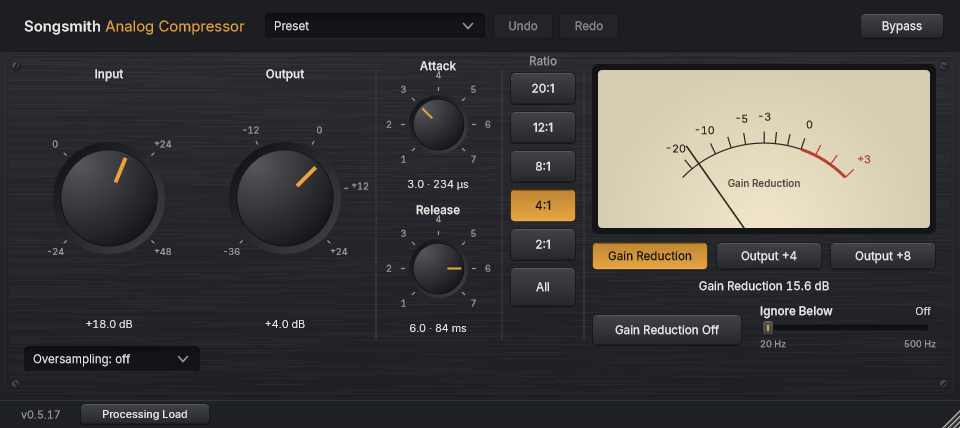

# Songsmith Analog Compressor

A feedback FET compressor inspired by the Rev D blackface 1176LN, by Songsmith Studio, built with JUCE and CMake. It is an original design, not a clone, and isn't affiliated with or endorsed by Universal Audio. First released on 2026-11-04 as [version 0.1.0](https://github.com/tonygward/audio-plugins/releases/tag/compressor-v0.1.0). Every Songsmith plugin now shares one version number: see the [changelog](../CHANGELOG.md).



*A real screenshot at 100 %, rendered by the test executable (`AnalogCompressorTests --screenshots`). Oversampling sits under the Input knob. Ignore Below is the slider beside Gain Reduction Off, from 20 Hz to 500 Hz, set to Off. Hover over a ratio button for a short description of how it sounds.*

## Features

- **The 1176-style controls:** Input drives the compression into a fixed threshold, Output matches the level, Attack (20-800 µs) and Release (50 ms-1.1 s) get faster clockwise, and there are four ratio buttons (4, 8, 12, 20). How they work: [docs/presets.md](docs/presets.md).
- **2:1 ratio (a Songsmith addition):** a fifth button, below 4:1, for gentle compression that evens out louder parts without squashing the sound. The original 1176 has no 2:1 button. It is separate from the four hardware ratios, so older sessions, presets and host automation keep exactly the ratio they saved; the default is still 4:1. Details, measurements and the compatibility design: [docs/two-to-one-ratio.md](docs/two-to-one-ratio.md).
- **All** (the All Buttons function): all four ratios pressed in, with its own curve, attack lag on transients and extra distortion. See [docs/all-buttons.md](docs/all-buttons.md).
- **Analogue colour:** FET gain-cell distortion while compressing, plus the Class A output amplifier and transformer. **Gain Reduction Off** keeps the colour without compressing. Calibrated to the published specs: [docs/colour.md](docs/colour.md).
- **Oversampling:** Off / 2x / 4x (default Off, so a new instance adds no delay and uses the least processing power; turn it up for a cleaner top end when compressing hard). Sessions saved earlier keep their setting. The latency is reported to the host, and the bypass stays aligned. If you switch Processing Load on (far left of the strip along the bottom of the editor), the readout beside it shows this instance's CPU use and that latency in milliseconds and samples.
- **Needle meter** (about 45 % larger than before, with bigger scale numbers): Gain Reduction, Output +4 and Output +8 modes (0 on the scale at +4 or +8 dBu) with VU ballistics, plus a numeric gain reduction readout.
- **Scalable vector editor:** 100-200 %, sharp on any display, on a fine brushed faceplate drawn as vectors. The ratio buttons read 20:1, 12:1, 8:1, 4:1 and (a Songsmith addition) 2:1, each with a plain tooltip. See [docs/editor.md](docs/editor.md).
- **Ignore Below (a Songsmith addition, formerly Low Cut):** a horizontal slider beside Gain Reduction Off, under the meter, with the name on the left and the frequency on the right (for example 127 Hz). It stops deep bass from making the compressor turn the whole sound down. Only what the compressor *listens to* is filtered; the bass you hear is untouched. Choose any whole number of Hz from 20 to 500 (gentle 12 dB/oct slope) by dragging, with the arrow keys, or by clicking the number and typing; double-click for Off. Off by default, including in sessions saved earlier, and sessions that used the old 60, 80, 100, 150 or 200 Hz steps keep exactly that frequency. The original 1176 has no such control. Details and tests: [docs/detector-low-cut.md](docs/detector-low-cut.md).
- **Title tooltip:** hover over the plugin name at the top left for a short explanation of what the compressor does and one thing to listen for. It is fixed wording, not a measurement. See [shared/docs/guidance.md](../shared/docs/guidance.md).
- **Presets:** four conservative, level-matched starting points (lead vocal, acoustic guitar, bass, drum room), each with a listening cue, plus your own presets.

## Install

Download the installers from the [releases page](https://github.com/tonygward/audio-plugins/releases/latest). CI builds the same files on every change (the [Actions page](https://github.com/tonygward/audio-plugins/actions/workflows/build.yml)). None of the files are code-signed. See the Songsmith EQ section of the main README for the SmartScreen and Gatekeeper steps, which are the same here.

| File (CI artifact) | What it is |
|---|---|
| `Songsmith-Analog-Compressor-Windows-setup` | `Songsmith-Analog-Compressor-<version>-win64-setup.exe`: VST3 into Common Files\VST3, plus a standalone app. Upgrades in place. Uninstall from **Settings → Apps**. Your presets are kept. |
| `Songsmith-Analog-Compressor-Windows-zip` | The VST3 bundle and the standalone `.exe`, for a manual install |
| `Songsmith-Analog-Compressor-macOS-pkg` | Universal installer: VST3, AU and the standalone app |
| `Songsmith-Analog-Compressor-macOS-zip` | Universal VST3, AU and `.app`, for a manual install |

It installs alongside Songsmith EQ and never touches it. To uninstall on macOS, run `installer/macos/uninstall.sh`.

## Build and test

From the `analog-compressor` folder:

```powershell
cmake -B build -G "Visual Studio 18 2026" -A x64 -DJUCE_DIR=C:/dev/JUCE   # macOS: -G Xcode -DCMAKE_OSX_ARCHITECTURES="arm64;x86_64"
cmake --build build --config Release
.\build\AnalogCompressorTests_artefacts\Release\AnalogCompressorTests.exe          # unit tests
.\build\AnalogCompressorTests_artefacts\Release\AnalogCompressorTests.exe --bench  # CPU per oversampling setting
```

Other reports from the test app:

| Command | Prints |
|---|---|
| `AnalogCompressorTests --timing` | Measured attack and release times |
| `AnalogCompressorTests --colour` | Harmonics, aliasing, frequency response and latency |
| `AnalogCompressorTests --screenshots <folder> [--scale 2]` | Renders the editor |

During development, load the plugin from the build folder (see [docs/smoke-test.md](docs/smoke-test.md)) rather than installing it system-wide.

To build and test the installers:

- Windows: `.\installer\build-installer.ps1 -Zip`, then `.\installer\test-installer.ps1`. This test is isolated: it runs in a temp folder and needs no admin rights.
- macOS: `installer/macos/build-installer.sh`. Its test, `installer/macos/test-installer.sh`, installs system-wide, so it only runs on CI.

## Identity

**Never change these once released.**

- Manufacturer code `Tnyw`, plugin code `Sfc1`, so the AU is `aufx Sfc1 Tnyw`.
- Windows AppId `{FF3BD6A4-58D4-4AFA-BFA3-26B221E29340}`.
- macOS package ids `com.songsmithstudio.songsmithanalogcompressor.{vst3,au,app}`.
- Parameter IDs (stable): `input`, `output`, `attack`, `release`, `ratio`, `allButtons`, `grOff`, `bypass`, plus `oversampling` since state version 2 and `detectorLowCut` since state version 3. See `Source/FETParams.h`.

## Docs

| File | Contents |
|---|---|
| [references.md](docs/references.md) | Sources, and every design claim marked as published or as a modelling choice |
| [engine.md](docs/engine.md) | The feedback loop and timing measurements |
| [colour.md](docs/colour.md) | Analogue colour and oversampling |
| [all-buttons.md](docs/all-buttons.md) | All Buttons |
| [editor.md](docs/editor.md) | The editor |
| [detector-low-cut.md](docs/detector-low-cut.md) | The detector Low Cut: range, slope, tests and listening notes |
| [presets.md](docs/presets.md) | How the controls work, and the starting points |
| [daw-checks.md](docs/daw-checks.md) | Studio One and Logic checks, executed vs pending |
| [smoke-test.md](docs/smoke-test.md) | Studio One smoke test |
