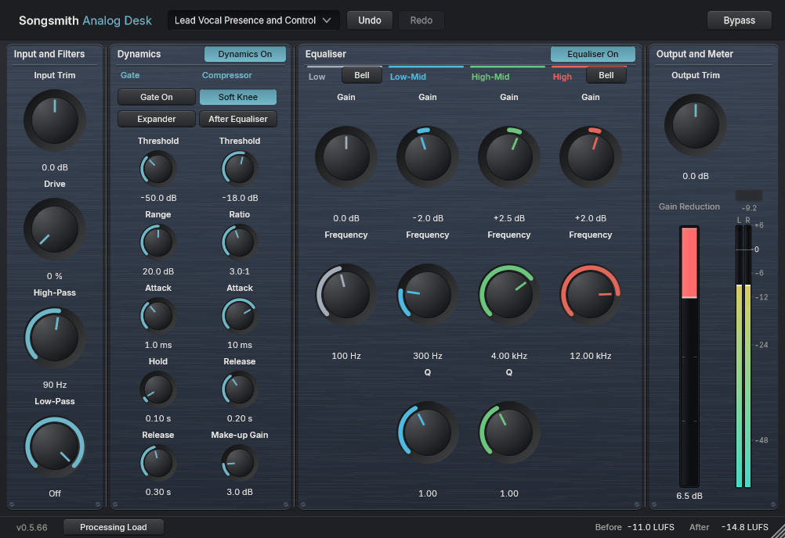
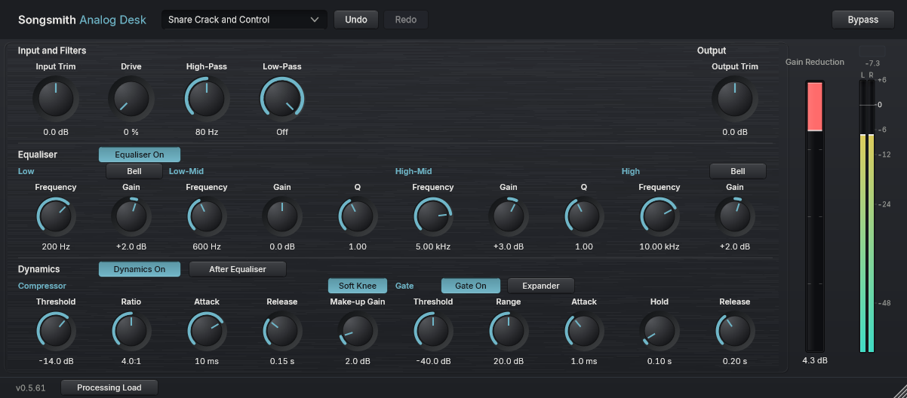

# Songsmith Analog Desk

A mixing desk channel strip in one plugin, by Songsmith Studio, built with JUCE and CMake: filters, a four-band equaliser, a gate or expander and a compressor, with a little warm Drive at the front. It is inspired by the arrangement of the SSL 4000 E series channel strip. It is an original design, not a copy, and is not affiliated with or endorsed by Solid State Logic.



*A real screenshot at 100 %, rendered by the test executable (`AnalogDeskTests --screenshot <file> --scale 1 --preset 0`). The earlier flat layout is [docs/images/editor-lead-vocal.png](docs/images/editor-lead-vocal.png).*



## The layout (songsmithstudio#9)

A console channel strip: four modules side by side, in the order the sound goes through them, separated by steel dividers on muted navy-grey metal.

| Module | What is in it |
|---|---|
| **Input and Filters** | Input Trim, Drive, High-Pass Filter, Low-Pass Filter, in one column of large knobs |
| **Dynamics** | the **Gate** (Gate On, Expander, Threshold, Range, Attack, Hold, Release) and the **Compressor** (Soft Knee, After Equaliser, Threshold, Ratio, Attack, Release, Make-up Gain) side by side, with **Dynamics On** in the header |
| **Equaliser** | four bands, a column each, colour coded: **Low** dark steel, **Low-Mid** cyan, **High-Mid** green, **High** red; Gain, Frequency and (for the two middle bands) Q down each, **Bell** on Low and High, **Equaliser On** in the header |
| **Output** | The suite's **Output** panel: the **Gain Reduction** bar and **Output** meter, a compact **Output Trim** knob under them, and **Auto Gain** beside it. Auto Gain keeps the loudness the same with the strip on as with it off, and Output Trim is applied after it, so your own setting has the last word. Auto Gain is off by default |

Nothing about the sound, the parameters, the starting points or the saved state changed. The shared title bar (preset menu, Undo, Redo, Bypass), the version and Processing Load strip and the Before and After readout are as in every plugin. The design is inspired by the arrangement of a classic console channel strip; it is not a copy of any product's panel, artwork, logo or lettering, and it makes no claim about circuit-level modelling.

## What it does

The sound goes through the strip from left to right and top to bottom:

- **Input and Filters.** **Input Trim**, **Drive** (a soft, warm rounding of the peaks; zero leaves the sound exactly as it is), a **High-Pass Filter** that removes rumble (18 dB per octave, all the way down is off) and a **Low-Pass Filter** that removes hiss (12 dB per octave, all the way up is off).
- **Equaliser.** Four bands: **Low**, **Low-Mid**, **High-Mid** and **High**, each with Frequency and Gain (up to 15 dB either way). The two middle bands also have **Q**, which sets how narrow they are. **Bell** makes the Low or High band a bell instead of a shelf. **Equaliser On** switches all four bands off together.
- **Dynamics.** A **Gate** (with **Expander**, which is gentler) and a **Compressor** (Threshold, Ratio, Attack, Release, Make-up Gain and **Soft Knee**). **Dynamics On** switches both off together. **After Equaliser** puts the dynamics after the equaliser instead of before it.
- **Output Trim**, and at the far right, as in every Songsmith plugin, a tall **Gain Reduction** bar (the compressor) and the **Output** meter. **Bypass** is at the top right.

The preset menu has starting points named for what they are used for (for example Lead Vocal Presence and Control, Kick Drum Punch, Mix Bus Gentle Glue), and you can save your own. Loading one is a single Undo step. The strip has no delay, so there is nothing to compensate for.

## Where the numbers come from

**Please read this before relying on any number.** Most of the SSL 4000 E's published figures could not be read when this was written, so almost every range here is a Songsmith design choice and has not been compared with a real unit. [docs/engine.md](docs/engine.md) lists, setting by setting, what follows a published description (an 18 dB per octave high-pass filter, a four-band equaliser with sweepable middle bands, a high band from 1.5 to 16 kHz, a high-mid band from 600 Hz to 7 kHz, an attack up to 30 ms, a soft knee) and what is our own choice, with the test that checks each. The starting points are Songsmith starting points, not copies of anyone's settings.

It does not model the console's circuits beyond the Drive.

## Not yet verified

- **Not yet verified in a DAW.** It has been tested with a simulated host only (3,000-plus automated checks on Windows and macOS: the engine, the parameters, saved sessions, presets and the editor).
- The engine has not been compared with a measurement of real hardware, and it has not been listened to.
- The macOS installer and the Audio Unit are built and tested on CI only.

## Saving

Everything you set is saved with your project, along with the window size. Your own presets are `.sspreset` files in `%APPDATA%\Songsmith Studio\Songsmith Analog Desk\Presets` (Windows) or `~/Library/Songsmith Studio/Songsmith Analog Desk/Presets` (macOS), a folder of its own.

## Building and testing

```powershell
cmake -S analog-desk -B analog-desk/build -G "Visual Studio 18 2026" -A x64 -DJUCE_DIR=C:/dev/JUCE
cmake --build analog-desk/build --config Release
.\analog-desk\build\AnalogDeskTests_artefacts\Release\AnalogDeskTests.exe
```
