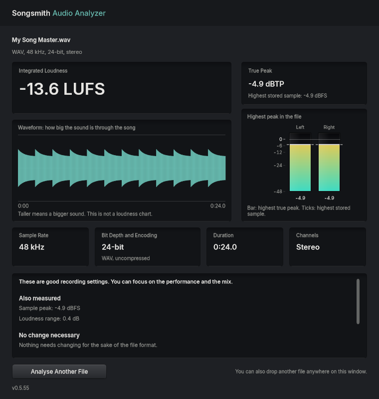
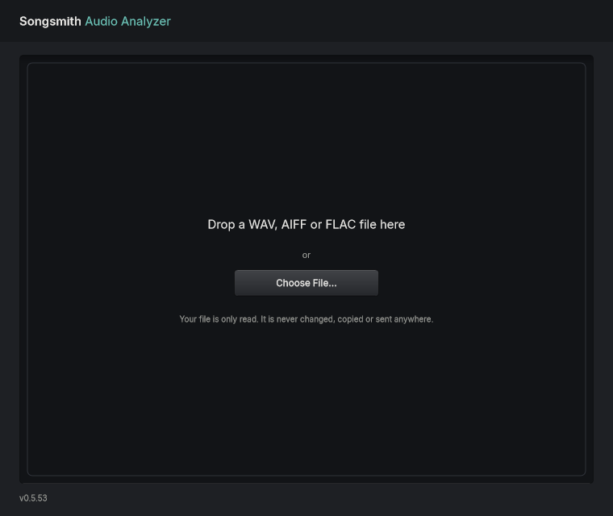
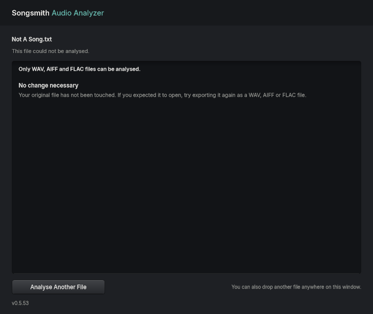
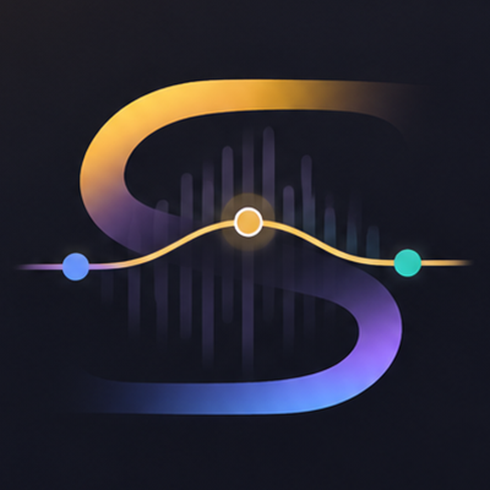

# Songsmith Audio Analyzer

A standalone app for checking a **finished song**. Open a WAV, AIFF, FLAC or MP3 file and it shows how loud the file is and how it was recorded, with short, optional advice in plain English. It needs no recording software, and it is not a plugin.







*Real screenshots at 100 %, rendered by the test executable (`AudioAnalyzerTests --screenshots <folder>`).*

## What it shows

| Reading | What it tells you |
|---|---|
| **Integrated Loudness** (LUFS) | How loud the whole file is on average, measured the way broadcasters and streaming services measure it (ITU-R BS.1770-4, with the standard's gates). |
| **True Peak** (dBTP) | The highest level the sound reaches once the stored samples are turned back into a smooth wave. It is measured on a 4× oversampled copy (2× from 96 kHz), so it can be a little above the highest stored sample. The highest stored sample is shown beneath it, clearly labelled as a sample peak. |
| **Sample Rate** | How many times a second the sound is stored. |
| **Bit Depth and Encoding** | How finely each sample is stored, and how the file is stored (uncompressed, lossless, floating point or compressed). This is how the file is kept, not how the sound was first recorded. An MP3 has no bit depth, so it says **Not applicable**, and shows that it is lossy with its average bitrate. |
| **Duration** | How long the file plays. |
| **Channels** | Mono, stereo or the number of channels. |

If a reading cannot be made, the box says **Not available** and why (for example, "Too short or too quiet to measure"). Nothing is invented.

Under the readings, **plain-English guidance** says what matters, why, and whether you need to do anything. It separates measured facts from listening suggestions and from what the tool cannot know. There is no score, no pass or fail and no platform target, because services and listeners normalise loudness in their own ways. It is the same guidance as the rest of Songsmith (REC-01, [shared/docs/file-recording-advisor.md](../shared/docs/file-recording-advisor.md)).

## Using it

1. Open the app. Drop a WAV, AIFF, FLAC or MP3 file on the window, or click **Choose File...** (shortcut: Ctrl+O, or Cmd+O on a Mac).
2. A progress bar shows while the file is read. A long file does not freeze the window, and **Cancel** (or Escape) stops it.
3. Read the results. Click **Analyse Another File**, or drop another file anywhere on the window.

If a file cannot be read (a different kind of file, a damaged file, a folder), the window says so in plain words and tells you what to try. Your file is only read: it is never changed, copied or sent anywhere.

The window scales as a whole from 75 % to 200 % and keeps its shape.

## MP3 files

An MP3 is a compressed (lossy) file, so a few things are different:

- **The readings are for the decoded sound.** The app turns the MP3 back into sound, the way a player does, and measures that. Loudness and true peak are those of what a listener hears, so they can differ a little from the WAV the MP3 was made from, and compression can push the loudest peaks slightly higher, even above 0 dBTP.
- **No bit depth.** It is not applicable to an MP3, so none is shown. The app shows **MP3, lossy** and the average bitrate (kilobits per second), worked out from the size and length of the file. For a variable bitrate file it is the average over the whole file.
- **Exact length.** The app counts the file's frames itself, so the length and average bitrate are exact for constant and variable bitrate files, with or without the headers some encoders add. This covers MP3 (MPEG Layer III) files at every sample rate music programs use.
- **Encoder silence.** An encoder adds a very short stretch of silence at the start and end (usually under a twentieth of a second). The app's decoder plays it, as most players do, and it counts towards the length. It has almost no effect on the loudness reading, and it is not trimmed.
- **Not knowable from an MP3:** the loudness and true peak of the original before it was compressed, and the settings it was recorded at.

The MP3 decoder is JUCE's own, built in, so there is nothing extra to install and no paid or system codec is used.

## Install

It comes in **Songsmith Plugins**, the one installer for each system, as its own tick box (selected by default):

- **Windows:** installs `Songsmith Audio Analyzer.exe` in `Program Files\Songsmith Studio\Songsmith Audio Analyzer` and adds a Start menu shortcut. Untick it on a later run to remove it. The exe, the shortcut and the taskbar button all show the Songsmith logo. If Windows still shows a plain icon after an update, it is showing a saved picture; sign out and in again, or restart, to refresh it.
- **Mac:** installs `Songsmith Audio Analyzer.app` in Applications, with the Songsmith logo as its icon. Finder can open WAV, AIFF, FLAC and MP3 files with it.

Like the plugins, the installers are not code-signed, so Windows SmartScreen or macOS Gatekeeper may warn the first time. See the [installation guide](../TECHNICAL.md).

## The icon

The icon is the Songsmith logo mark, cropped square from the official logo on the website (`Resources/songsmith-icon.png`, 1024 by 1024), not redrawn. The build embeds it in the exe at several sizes and makes the Mac icon from it. The installer tests check that the installed exe carries it and that the Start menu shortcut takes it from the app.



## Build and test

```powershell
cmake -S audio-analyzer -B audio-analyzer/build -G "Visual Studio 18 2026" -A x64 -DJUCE_DIR=C:/dev/JUCE
cmake --build audio-analyzer/build --config Release
.\audio-analyzer\build\AudioAnalyzerTests_artefacts\Release\AudioAnalyzerTests.exe
```

`AudioAnalyzerTests --screenshots <folder> [--scale 2]` renders the three screens (waiting, results, an error).

The tests write real reference files to a temporary folder (WAV 16-, 24- and 32-bit float, AIFF, FLAC, mono and stereo, and MP3 files built by hand from silent frames) and read them back through the same code the app uses:

- Known loudness: a 997 Hz sine reads the same number of LUFS as its level in dBFS (EBU Tech 3341), mono reads 3 dB lower, and a gated signal reads as the standard says.
- True peak: a wave that rises between samples reads about 3 dB above its highest stored sample, and a sample peak is never shown as a true peak.
- Missing measurements (silence, too short, too quiet), every error (missing file, wrong kind of file, folder, damaged file, empty file), repeated and cancelled analyses, a three-minute file read in the background with the window responsive, dropping several files.
- MP3 (ANA-02): valid MP3 files of silent frames at 32, 44.1 and 48 kHz, mono and stereo, at 64 to 320 kilobits per second, with a changing bitrate and with no header, twelve minutes long, cut short, empty and not an MP3 at all. They check the format, sample rate, channels, exact length, average bitrate, "Not applicable" for bit depth, silence reported as silence, and the words used.
- Plain words and text that fits at the smallest, default and largest window, in every screen; fonts from the embedded Inter typeface; keyboard use and screen reader names.
- The shared REC-01 analysis and advice tests (`shared/Tests/SongsmithFileAdvisorTests.h`) run here too.

## What has not been checked

- The app has not been tried on a real Mac by a person, and the macOS package is built and tested only on the hosted macOS runner. Opening a file from Finder (or by dropping it on the app's icon) is set up in the app's property list and checked there, but has not been tried by hand.
- **MP3 loudness and true peak are not yet checked against known-good encoded music.** No MP3 encoder was available to make reference files, so the tests cover everything about opening and describing an MP3 using hand-built silent files, and the decoder was run by hand on real MP3 files (readings looked right, and the exact length matched the decoder's frame count), but no MP3 with a known loudness is in the test suite. The decoded sound of a real MP3 is the decoder's output; the app does not remove the encoder's start and end silence.
- Reference files are generated; no commercially mastered files were used. True peak is checked on constructed signals with a known answer, not against another vendor's meter.
- Screen reader use is covered by the accessibility names and roles the tests check, not by a session with a screen reader.
