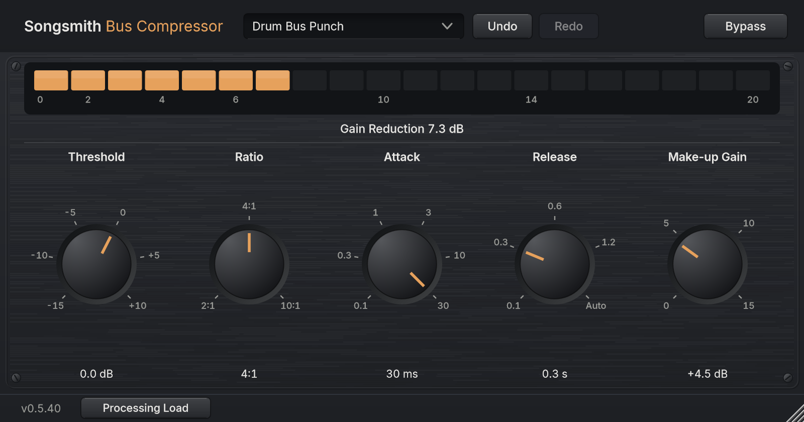
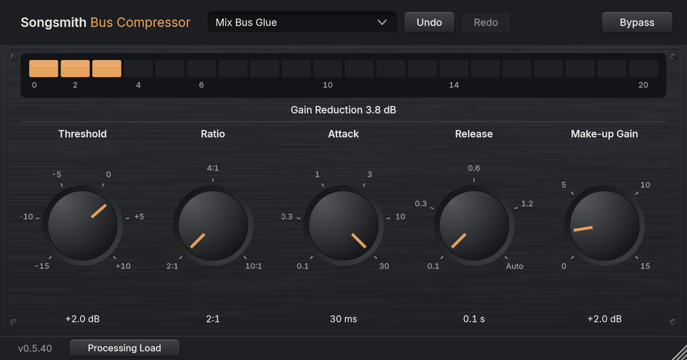

# Songsmith Bus Compressor

A bus compressor that glues a mix or a group of sounds together, inspired by the SSL 4000 G series bus compressor, by Songsmith Studio, built with JUCE and CMake. It is an original design, not a clone, and isn't affiliated with or endorsed by Solid State Logic. Every Songsmith plugin shares one version number: see the [changelog](../CHANGELOG.md).



*A real screenshot at 200 %, rendered by the test executable (`BusCompressorTests --screenshot <file> --scale 2 --preset 2`).*



## What it does

It turns the loud parts of a stereo sound down a little, so the whole thing sits together. Both channels always get the same gain, so the stereo picture does not move. There are five controls:

- **Threshold** is the level where the compressor starts working. Turn it down and more of the sound is compressed.
- **Ratio** is how firmly the sound above the threshold is turned down: 2:1 is gentle, 4:1 is firm, 10:1 is very firm.
- **Attack** is how quickly it reacts: 0.1 to 30 ms. A slower attack lets the first part of each hit through.
- **Release** is how quickly it lets go: 0.1 to 1.2 s, or **Auto**, which lets go quickly after a short hit and slowly after a long loud passage.
- **Make-up Gain** adds back the level that compressing took away.

The row of lamps at the top is the **Gain Reduction** meter, one lamp for each decibel. Also: **Bypass** at the top right, **Undo** and **Redo**, a **Preset** menu with five starting points and your own saved presets, and **Processing Load** at the bottom left.

## Where the numbers come from

The steps of Ratio, Attack and Release follow the published values for the hardware. Everything else (the Threshold dial's scale, the knee, the detector, how Auto release works, the Make-up Gain range) is a Songsmith design choice. [docs/engine.md](docs/engine.md) lists which is which, with the test for each, and says which published figures could not be confirmed. [docs/presets.md](docs/presets.md) records where the starting points come from.

It does not model the console's circuits or a sidechain filter, so it compresses without adding that colour.

## Not yet verified

Not tried in a real DAW, no level-matched listening notes yet, and Joe Gilder's tutorials have not been watched. See the checklist in [docs/presets.md](docs/presets.md).

## Build and test

```powershell
cmake -S bus-compressor -B bus-compressor/build -G "Visual Studio 18 2026" -A x64 -DJUCE_DIR=C:/dev/JUCE
cmake --build bus-compressor/build --config Release
.\bus-compressor\build\BusCompressorTests_artefacts\Release\BusCompressorTests.exe
```
