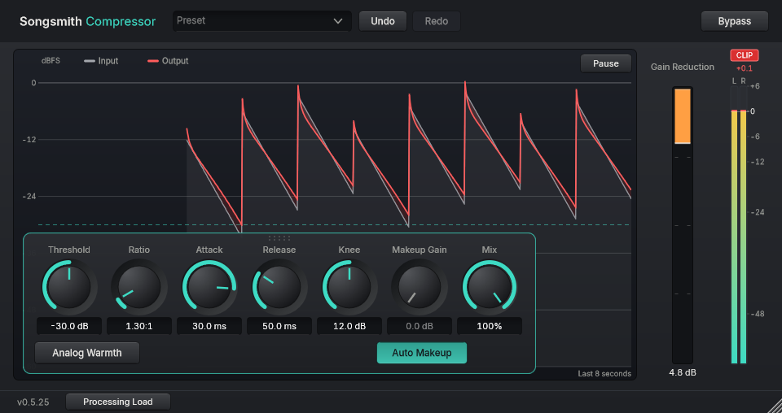
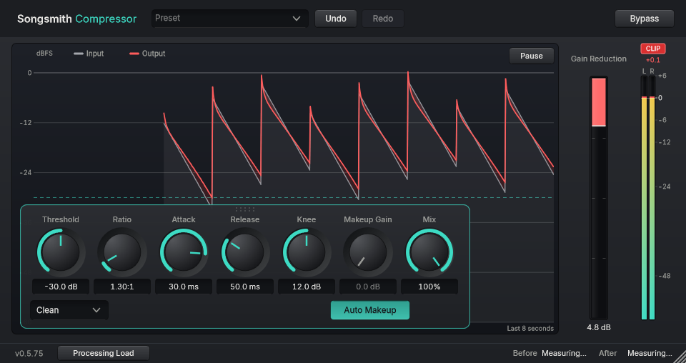
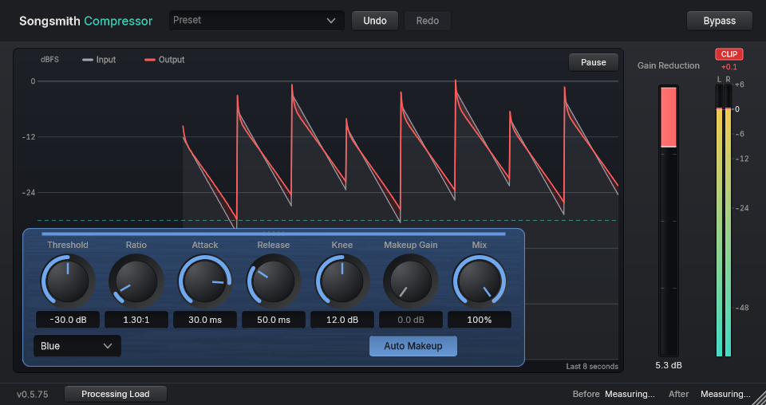
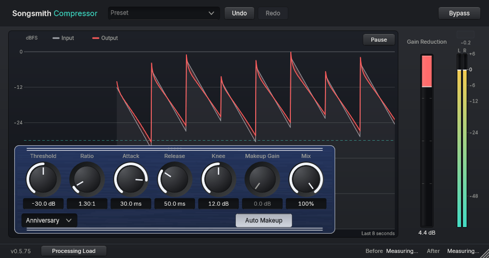

# Songsmith Compressor

A simple, clear compressor: it turns the louder parts of a sound down so the level stays more even. It is separate from [Songsmith Analog Compressor](../analog-compressor/README.md), which is modelled on a fast, analogue-style design. Songsmith Compressor has ordinary Threshold, Ratio, Attack and Release controls and, unless you switch on Analog Warmth, no analogue character, so it is a good choice when you want to smooth a sound without changing its tone.



## What you see

A graph of the last 8 seconds fills the window: **grey is the sound going in, red is the sound coming out**. When the red line falls below the grey one, the compressor is turning the level down. The dashed line is your Threshold. **Pause** holds the picture so you can look at it; the sound carries on.

The controls float in a panel on the graph. Drag it by its background to move it out of the way; it remembers where you put it. On the right, **Gain Reduction** shows how much the level is being turned down, and the output meter is the same one as in Songsmith EQ (it shows each channel, and the held peak with a CLIP warning).

## Controls

- **Threshold:** the level above which the sound is turned down. Lower it to compress more of the sound.
- **Ratio:** how firmly the sound above Threshold is turned down. Near 1 to 1 is very gentle; higher is firmer.
- **Attack:** how quickly the turning down starts. A slower attack lets the start of each note through.
- **Release:** how quickly the sound returns to full level.
- **Knee:** how gradually the turning down begins around Threshold. 0 is abrupt; larger is smoother.
- **Makeup Gain** and **Auto Makeup:** raise the level after compression. Auto Makeup matches the level for a typical signal of -18 dBFS, so you do not have to; switch it off to set Makeup Gain yourself.
- **Mix:** blends the compressed sound with the original, for parallel compression.
- **Model** (songsmithstudio#23): one dropdown at the bottom left of the floating panel with five choices, **Clean**, **Black**, **Blue**, **Anniversary** and **Lindell**. **Clean** is the Compressor's own transparent sound, with no analogue colour. The other four are the same four models, with the same code, as the [Songsmith Analog Compressor](../analog-compressor/README.md); they add a little smooth, rounded colour to the compressed sound (quiet and normal levels keep the same loudness, and only the loudest peaks are rounded off slightly). Choosing a model changes only the model: Threshold, Ratio, Attack, Release, Knee, Makeup Gain and Mix stay as you set them, and Undo puts the old choice back in one step. Hover the dropdown for what the model shown is for. Clean is the default, so leave it there if you want the sound to stay clean; there is no right or wrong setting, so choose by ear.
- **The panel's colours follow the model.** The floating panel's surface, outline, knob rings and lit buttons take the colours of the same model in the Songsmith Analog Compressor: amber for Black, blue with a stripe for Blue, deep navy with pinstripes for Anniversary, grey with fine lines for Lindell. Clean keeps the Compressor's teal. Any analogue model also gives the panel the fine brushed-metal texture. The graph, the meters and the title do not change colour.
- **Older projects:** a project saved with Analog Warmth off opens on **Clean**; one saved with Analog Warmth on and a model opens on that model; one saved with Analog Warmth on from before the models existed keeps its original sound, and the dropdown reads **Classic** until you choose a model. Nothing sounds different.

    

  *Real screenshots, rendered by the test executable (`CompressorTests --screenshot <file> --look 0` to `--look 4`).*
- **Preset:** starting points for a kind of sound: Acoustic Guitar, Lead Vocal Control, Drum Bus Glue and Gentle Level Smoothing. Adjust Threshold by ear afterwards.
- **Undo, Redo and Bypass** work as in every Songsmith plugin.

The meters show the input and output peak and how much the compressor is turning the level down (Gain Reduction). The input and output meters show sample peak, not true peak. A red mark means a sample reached 0 dBFS; click a meter to clear it.

Do you need to do anything? Not much. Pick a preset, then move Threshold until Gain Reduction moves a little on the loud parts. If it never moves, the compressor is not changing the sound.

## Good to know

There is no latency, no look-ahead and no oversampling, including with Analog Warmth on.

This version has not yet been checked in a DAW.

More detail: [engine notes](docs/engine.md), [graph, panel and meters](docs/display.md), [preset notes](docs/presets.md).

## Building

```powershell
cmake -S compressor -B compressor/build -G "Visual Studio 18 2026" -A x64 -DJUCE_DIR=C:/dev/JUCE
cmake --build compressor/build --config Release
.\compressor\build\CompressorTests_artefacts\Release\CompressorTests.exe
```
