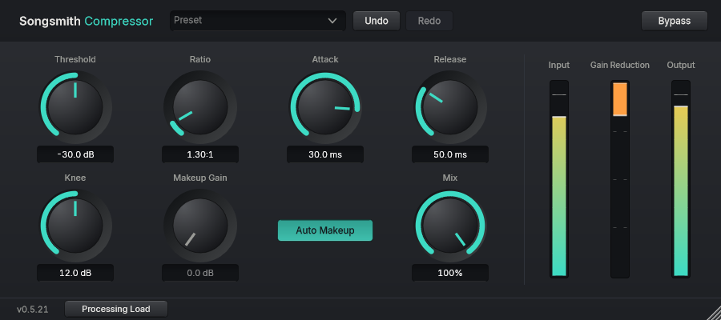

# Songsmith Compressor

A simple, clear compressor: it turns the louder parts of a sound down so the level stays more even. It is separate from [Songsmith Analog Compressor](../analog-compressor/README.md), which is modelled on a fast, analogue-style design. Songsmith Compressor has ordinary Threshold, Ratio, Attack and Release controls and no analogue character, so it is a good choice when you want to smooth a sound without changing its tone.



## Controls

- **Threshold:** the level above which the sound is turned down. Lower it to compress more of the sound.
- **Ratio:** how firmly the sound above Threshold is turned down. Near 1 to 1 is very gentle; higher is firmer.
- **Attack:** how quickly the turning down starts. A slower attack lets the start of each note through.
- **Release:** how quickly the sound returns to full level.
- **Knee:** how gradually the turning down begins around Threshold. 0 is abrupt; larger is smoother.
- **Makeup Gain** and **Auto Makeup:** raise the level after compression. Auto Makeup matches the level for a typical signal of -18 dBFS, so you do not have to; switch it off to set Makeup Gain yourself.
- **Mix:** blends the compressed sound with the original, for parallel compression.
- **Preset:** starting points for a kind of sound: Acoustic Guitar, Lead Vocal Control, Drum Bus Glue and Gentle Level Smoothing. Adjust Threshold by ear afterwards.
- **Undo, Redo and Bypass** work as in every Songsmith plugin.

The meters show the input and output peak and how much the compressor is turning the level down (Gain Reduction). The input and output meters show sample peak, not true peak. A red mark means a sample reached 0 dBFS; click a meter to clear it.

Do you need to do anything? Not much. Pick a preset, then move Threshold until Gain Reduction moves a little on the loud parts. If it never moves, the compressor is not changing the sound.

## What it does not have yet

Analog Warmth (an optional, subtle colour control) is planned and is not in this version. There is no latency and no look-ahead.

This version has not yet been checked in a DAW.

More detail: [engine notes](docs/engine.md), [preset notes](docs/presets.md).

## Building

```powershell
cmake -S compressor -B compressor/build -G "Visual Studio 18 2026" -A x64 -DJUCE_DIR=C:/dev/JUCE
cmake --build compressor/build --config Release
.\compressor\build\CompressorTests_artefacts\Release\CompressorTests.exe
```
