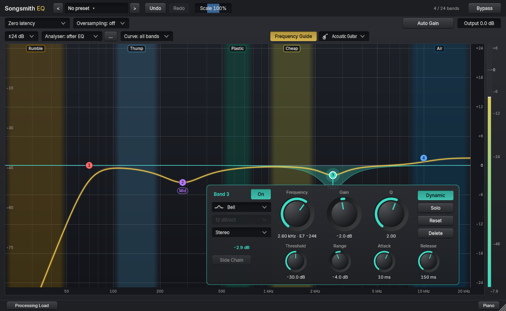
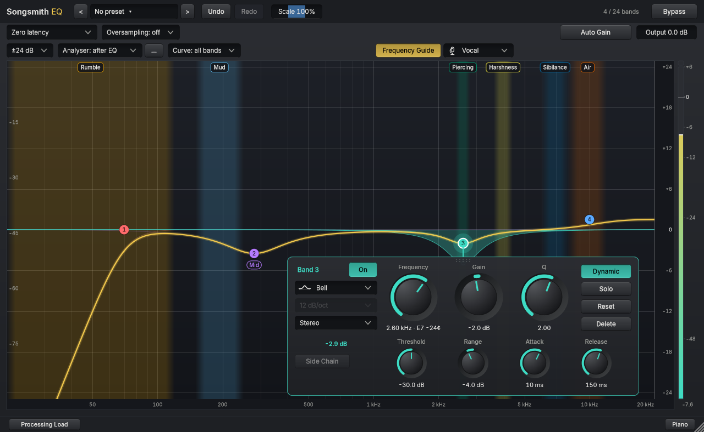
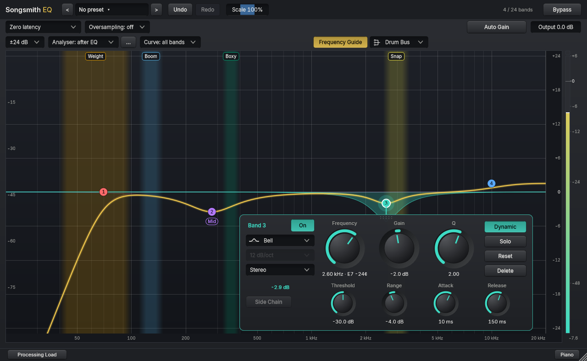
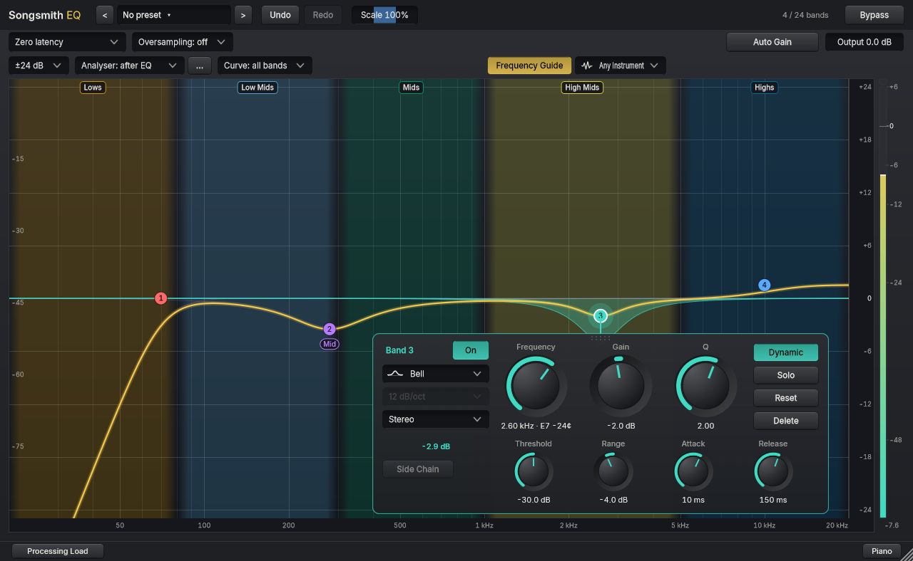

# Instrument Frequency Guide

An optional, see-through set of coloured regions behind the Songsmith EQ graph, with a plain word on each (**Rumble**, **Thump**, **Plastic**, **Air** and so on). It helps you hear what a part of the sound is before you have to think in frequencies. Task [EQ-32](../prompts/done/32-frequency-guide.md).

**It only draws.** It never changes a band, a setting or the sound, it is off by default, and loading a starting point never turns it on or changes the instrument. The regions are places to listen, not rules: every tooltip says "around", and a cut only helps if you can hear the problem.

## Using it

In row 3, just above the graph, press **Frequency Guide** and choose the instrument beside it. Hover a region to read what it adds, what too much sounds like, and when it is usually moved. Where two regions overlap (for example Melody and String Noise on a nylon guitar) both explain themselves together. Hovering a band shows that band's readout instead, and the guide never gets in the way of selecting or dragging a band: the nodes are drawn on top.

The choice is saved with the session like the piano strip (it is editor state, not an automatable parameter). Sessions saved before this version load with the guide off.

## Instruments, in the order of the list

| Instrument | Words, from low to high |
|---|---|
| Acoustic Guitar | Rumble, Thump, Plastic, Cheap, Air |
| Nylon Guitar | Rumble, Boom, Boxy, Melody, String Noise, Air |
| Electric Guitar | Boom, Mud, Warmth, Aggression, Crunch |
| Bass Guitar | Weight, Mud, Boxy, Click |
| Vocal | Rumble, Mud, Piercing, Harshness, Sibilance, Air |
| Kick Drum | Weight, Boom, Boxy, Snap |
| Snare Drum | Boom, Boxy, Snap |
| Toms | Body, Boxy, Attack, Air |
| Drum Bus | Weight, Boom, Boxy, Snap |
| Any Instrument | Lows, Low Mids, Mids, High Mids, Highs |

User-facing explanations should describe what the musician might hear and whether action is optional, without naming the tutorial author. Research attribution stays here and in source metadata; this distinction is tracked in [SUI-14](../../shared/prompts/SUI-14-neutral-tooltips-and-tonal-language.md).\n\nEvery region has a `source` in [`eq/Source/FrequencyGuide.h`](../Source/FrequencyGuide.h) (not shown on screen): the video and time of Joe Gilder's advice, or the note file of Tony's. A test checks that each region has one, and that every file Tony's notes name exists.

## Where the words come from

- **Joe Gilder**'s [Home Studio Corner](https://www.youtube.com/@HomeStudioCorner) videos, wherever he gave a word: the five groups from *Frequency Fluency* (2026-09-06), the 2026 *5-Minute Mix* EQ videos for bass, electric guitar, acoustic guitar, drums and vocals, and older videos such as *How I EQ Acoustic Guitar* ("three cuts and a boost", 2021-12-02).
- **Tony's own notes** (the `music-recording` folder: instrument notes, the mixing notes for *Acoustic Moods*, and his tom settings on *Between You and Me*) for Nylon Guitar, Toms and the extra sentences about pickups, a 12-string and full mixes.
- The words are not endorsed by Joe Gilder. The transcripts are auto-generated captions, so every figure was checked against the caption text or the note file before it was used.

## Choices made while building it

- **Plastic and Cheap.** Joe uses "plastic" for two ranges on an acoustic guitar: 500 to 800 Hz in 2021 and 1 to 2 kHz in 2026. The guide keeps both, with two words: **Plastic** (his original name) for 500 to 800 Hz and **Cheap** (his 2026 word) for 1 to 2 kHz.
- **Electric guitar tone.** Joe says about 90 per cent of an electric guitar's tone in the mix is made during recording (2026-09-09); the earlier notes had "80 to 90", so the guide uses the transcript's figure.
- **Bass.** One figure in the notes was checked against Joe's 2019 video, where he says "one hundred and forty Hertz" in words.
- **Plain wording.** The tooltips pass the suite's plain-words test: a low B on a five-string bass is written as "about 31 Hz" and "that low note", because every word on screen is spelled out. The shared checker now also treats a new line as the start of a sentence.
- **Colour is a second cue.** The words always say what a region is. The hues are the colour-blind-safe set by Okabe and Ito.
- **Words that would overlap move down a row; a word is never shortened.** At the smallest size an open band panel can cover some words; drag the panel away to see them, and the regions still explain themselves on hover.
- **Minimum editor width.** The guide controls need more room in row 3 than the old 760 px minimum (the reserved Side Chain box alone is 230 px wide), so the smallest editor is now 980 px wide at 100 %. Windows saved smaller open at the new minimum.
- **Saved state.** Two new editor-state properties (`frequencyGuide`, `guideInstrument`), read with defaults, so `stateVersion` is unchanged, as for the piano strip. A test loads a session without them and checks the guide is off.

## Not included, possible follow-ups

Piano and keys, backing vocals, overheads and cymbals, and separate Acoustic Guitar variants (full mix, pickup, 12-string). The notes don't have enough detail for them yet, or the variants are covered by tooltips.

## Instrument icons (EQ-38)

Each instrument in the selector has a small drawn icon beside its full name, both in the list and on the closed selector, so the ten choices are quick to scan. The icons are vector drawings, so they stay crisp at every interface size and look the same on Windows and macOS. They are presentation only: the names, ordering, frequency ranges, saved sessions and audio are unchanged.

