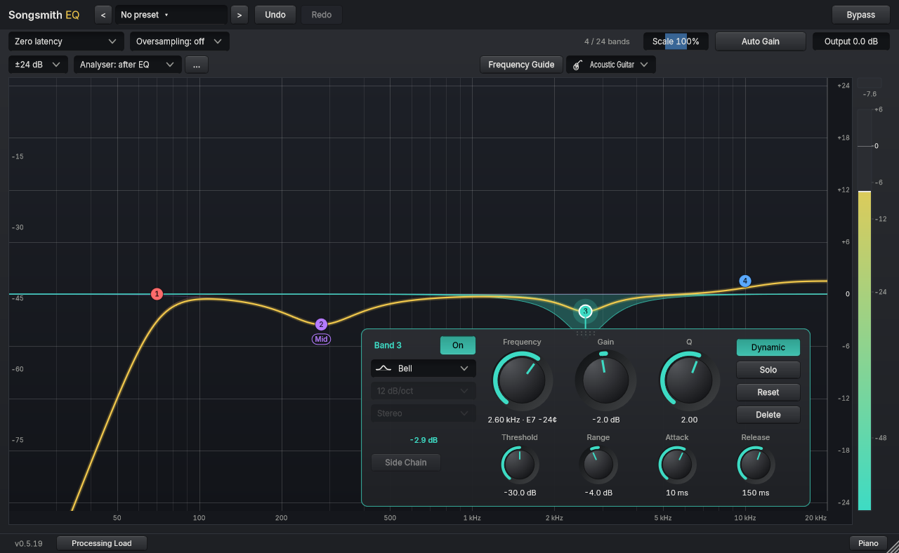
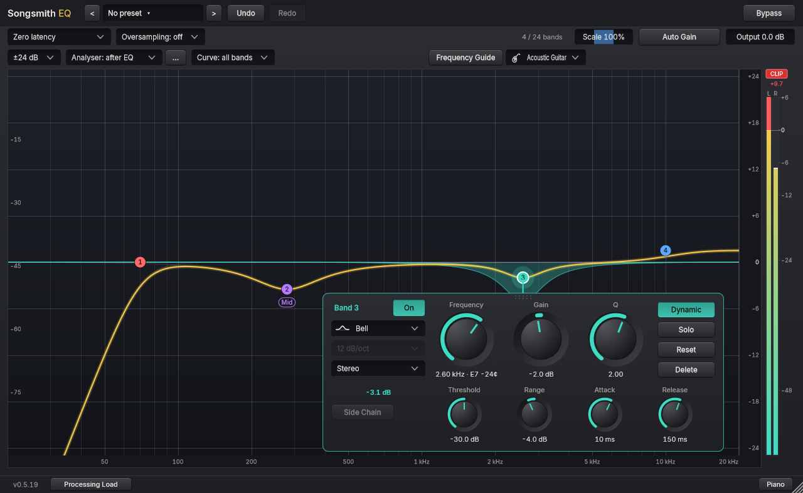
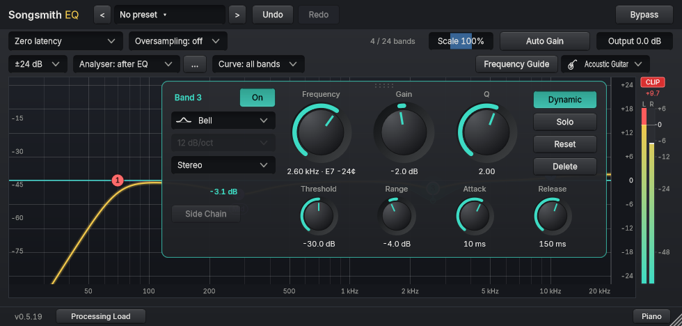

# Output meter and CLIP warning

The meter on the right of the graph matches your track: **two bars (Left and Right) on a stereo track, one bar on a mono track**. Each bar shows the level of that channel after the EQ and the output gain. From the top, the meter shows the **CLIP** warning, the **held peak number** directly beneath it, the channel names, and then the bars.

## The held peak number

- It is the highest sample level held for 1.5 seconds, in dBFS, and it keeps its real sign. **Negative means below 0 dBFS** (for example -0.6 is 0.6 dB under full scale). **Positive means over 0 dBFS** (+0.2 is 0.2 dB over).
- It is **red only while the held peak is at or above 0 dBFS**. A negative number is never red, even while CLIP is still lit from an earlier clip.
- Click the meter to clear the held number. A dash means there is no signal.

## The CLIP warning

A red **CLIP** label appears when any sample of either channel reaches or passes 0 dBFS. This is **sample peak**: it is measured on the samples your host receives, after the EQ and the output gain, not as a true-peak (inter-sample) reading, so a true peak can be higher than the number shown.

- **Exactly 0 dBFS counts.** A sample at full scale cannot be told apart from a clipped one, so it lights CLIP and shows a red 0.0. Material limited to a ceiling below 0 dBFS (for example -1 dBFS) does not light CLIP. There is no hidden tolerance: a real +0.2 dBFS peak is never hidden.
- **Why a limited master can still light CLIP:** the limiter's ceiling is exactly 0 dBFS; or the EQ boosts or Output gain push it over; or an earlier clip is still latched.
- **It stays lit while sound continues**, even if the level drops, so a brief clip is not missed. This means CLIP can be lit while the number is negative: the number shows the measured peak, CLIP remembers that one happened.
- **It clears by itself** once the output has been silent (below -80 dBFS on every channel) for three quarters of a second. A short musical pause does not clear it. A stereo track with one quiet-but-audible channel keeps it lit.
- **Do you need to do anything?** Not always. A level over 0 dBFS can distort when it is rendered or sent to the next stage, but a later plugin may have headroom. If CLIP lights and you are not sure the next stage has room, lower Output or the boosts.
- Opening a session, or moving the plugin to a track with a different channel layout, starts with no warning.

This changes only the display. The sound, parameters and saved sessions are unchanged. Not yet verified in a DAW.

