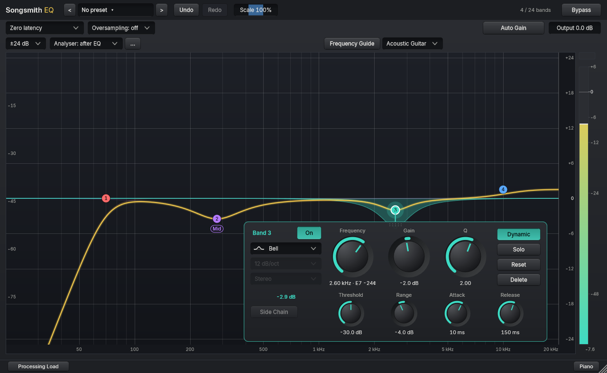
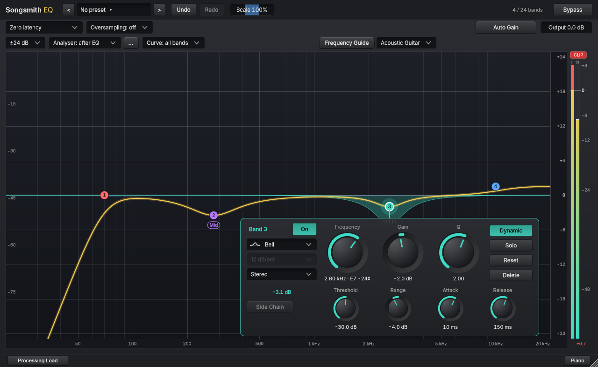
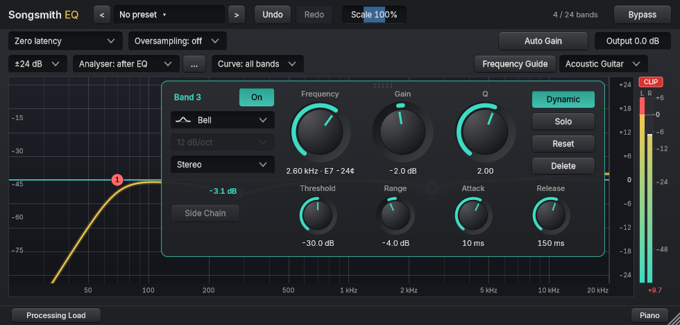

# Output meter and CLIP warning

The meter on the right of the graph matches your track: **two bars (Left and Right) on a stereo track, one bar on a mono track**. Each bar shows the level of that channel after the EQ and the output gain, and the number underneath is the highest held peak.

A red **CLIP** label appears above the meter when any sample of either channel reaches or passes 0 dBFS. This is sample-peak clipping: it is measured on the samples your host receives, not as a true-peak (inter-sample) reading.

- **It stays lit while sound continues**, even if the level drops, so a brief clip is not missed.
- **It clears by itself** once the output has been silent (below -80 dBFS on every channel) for three quarters of a second. A short musical pause does not clear it. A stereo track with one quiet-but-audible channel keeps it lit.
- **Do you need to do anything?** Often not. A single clip can be harmless, for example before a limiter or when the next plugin has headroom. If you can hear distortion, lower the Output gain or the boosts.
- Opening a session, or moving the plugin to a track with a different channel layout, starts with no warning.

This changes only the display. The sound, parameters and saved sessions are unchanged. Not yet verified in a DAW.

