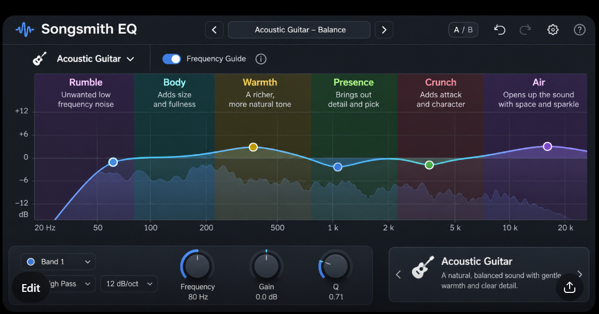

You are an experienced C++ audio developer and UI engineer working on **Songsmith EQ** (by Songsmith Studio), a JUCE VST3/AU/Standalone parametric EQ. Repo: `C:/dev/audio-plugins`, plugin in `eq/`. JUCE is at `C:/dev/JUCE`.

You may be running **unattended**. Nobody will answer questions. When something is unclear, choose the most sensible option, keep going, and record the decision in the PR description.

## Working rules (apply to every task)

**Git**
- Start from an up-to-date `main`: `git checkout main && git pull`, then create the branch named below.
- Never commit to or push `main`. Never force-push.
- Commit in logical steps with clear messages.

**Read first**
- `CLAUDE.md` (design principles), `docs/style-guide.md` (type scale, colours, plain words), `eq/ROADMAP.md` and `eq/docs/starting-points.md`.
- The editor: `eq/Source/PluginEditor.cpp` (`layoutContent()`, the top bar), the graph and analyser drawing, and how task 28's piano toggle is drawn, saved with the session and tested (`eq/prompts/done/28-piano-strip-toggle.md`).
- The sources in the **Source register** below. Tony's notes are also local, in `C:/dev/music-recording`.
- Work with the existing architecture. Don't rewrite it.

**Compatibility (must not break)**
- Never rename or remove parameter IDs, and never change `PLUGIN_MANUFACTURER_CODE` / `PLUGIN_CODE`.
- The guide is editor state, like the piano toggle: saved with the session, **not** an automatable parameter. If the saved-state layout changes, bump `stateVersion` and add a test that older sessions still load with the guide off.

**Real-time safety**
- The guide is drawing only. Nothing in `processBlock` or `Engine::process` changes.

**Build and test (from `eq/`)**
- `cmake --build build --config Release`. If `build/` is missing, first run `cmake -B build -G "Visual Studio 18 2026" -A x64 -DJUCE_DIR=C:/dev/JUCE`.
- The build must succeed with no new warnings.
- `.\build\EQTests_artefacts\Release\EQTests.exe` must pass every test. Add tests in the existing `juce::UnitTest` style.
- **Do not run `install.ps1`.**

---

# Task 32: Instrument frequency guide

**Branch:** `roadmap/32-frequency-guide`

Build the **Acoustic Guitar** guide first, with the instrument list ready for more. Add the **Electric Guitar** guide too if the acoustic one is done and tested. Bass, Vocal and Drums are later tasks. The design write-up below is Tony's: follow it. Where it conflicts with `CLAUDE.md` or the style guide (for example plain words, no abbreviations, the bevelled control look), `CLAUDE.md` wins.

The concept picture shows things Songsmith EQ doesn't have (A/B, undo and redo, a share button, an instrument card). Only build the **Frequency Guide** toggle, the instrument selector and the coloured regions with their labels and tooltips. Fit them into the current editor layout.

---

## Design: Songsmith EQ — Instrument Frequency Guide

**Status:** proposed feature · **Product:** Songsmith EQ · **Date:** 4 November 2026

> **Purpose:** Help musicians understand *what they are hearing* before asking them to learn frequency numbers. The guide is an optional visual overlay, not an automatic EQ or a substitute for listening.

## Concept screenshot

*Figure 1 — Design reference, not a screenshot of an implemented feature. The interface, colour bands, text and EQ curve are illustrative. In particular, “Crunch” is more strongly associated with electric guitar and should not be a default acoustic-guitar label; the recommended acoustic guide below replaces that generic illustration with terms grounded in the source notes.*

## Intended experience

A musician opens **Songsmith EQ**, enables **Frequency Guide**, and chooses the instrument being recorded. A subtle, transparent annotation appears *behind* the normal EQ response and analyser. Instead of memorising that a problem is at 500 Hz, the musician can read **Plastic** and learn what to listen for. Instead of memorising 8–12 kHz, they can read **Air**.

The musician remains in control. The guide **does not change the EQ response**, enable filters, guess which frequencies are bad, or suggest that boosting a labelled zone is always helpful. Existing presets and all technical controls remain available.

**Core principle:** *Musical words first; frequencies when useful.*

## Proposed acoustic-guitar overlay

The first implementation should use **Acoustic Guitar** as its reference instrument, with the vocabulary grounded in Joe Gilder's *three cuts and a boost* lesson and Tony's recorded acoustic-guitar EQ settings.

| Approximate position | Friendly term | Plain-English guidance | Evidence and provenance |
|---|---|---|---|
| Below ~40–50 Hz | **Rumble** | Very low noise that generally adds little to an acoustic part; listen before using a low cut. | Joe Gilder, *Three Cuts and a Boost* (2021), 2:07. Tony's recorded steel-string parts commonly use a **50 Hz low cut**. |
| Around ~150–170 Hz | **Thump** | The percussive body of a strum; too much can be boomy, but removing too much makes the guitar thin. | Joe at 3:39 describes an adjustment around **150 Hz**; Tony's saved settings include **164 Hz**. |
| Around ~500–800 Hz | **Plastic** | A boxy, hollow, or artificial-sounding quality; try a *small* cut only when heard. | Joe at 5:13–5:55; Tony's acoustic tracks use a **~510 Hz cut**. |
| Around ~1–2 kHz | **Cheap / hard edge** | An upper-mid sound that can become unpleasant on hard strums; assess the actual performance. | Joe's more recent acoustic guidance; Tony uses a **dynamic ~1.75 kHz** reduction on some acoustic tracks. |
| Above ~8 kHz | **Air** | Pick detail and openness; too much can emphasise scratch and noise. | Joe at 6:58 recommends a restrained upper shelf; Tony's acoustic settings include **+1 dB around 12.9 kHz**. |

The overlays are **listening regions**, not hard boundaries. They should visually fade/overlap rather than imply an instrument has perfectly separate frequency compartments. The acoustic guide should not label the entire 200–400 Hz range “Warmth” as a recommendation to boost: instrument, arrangement and microphone placement change whether that region is desirable warmth or problematic boom.

### Recorded-music grounding: three different acoustic contexts

Tony's `music-recording` repository makes a compelling case for **instrument + context**, rather than one universal acoustic-guitar map:

| Context | What the recording notes show | Implication for the guide |
|---|---|---|
| **Acoustic Moods — steel-string rhythm (Tony)** | A common starting point is a **50 Hz high-pass**, a cut near **510 Hz**, a dynamic dip around **1.75 kHz**, and restrained high-shelf lift. The proposed *full-mix rhythm* approach uses a **100–120 Hz high-pass**, **200–350 Hz** boom management and a small **1.5–2.5 kHz** pocket for the nylon lead. | Keep “Rumble”, “Plastic”, “Hard edge” and “Air”, but explain that low cuts and midrange choices depend on whether the guitar is solo or supporting the arrangement. |
| **Acoustic Moods — nylon lead (Chris)** | The mixing notes prioritise Chris's **1–3 kHz melodic presence**, with a low cut near **80 Hz** and attention to **180–250 Hz** boom. DI/piezo versions may need a dynamic reduction near **2 kHz** to control pickup harshness. | **Nylon Lead** should have a different overlay from steel-string rhythm: “Body”, “Boom”, “Melody / Presence” and “String noise” may matter more than a generic “Crunch” label. Do not lead the user to cut the very frequencies carrying the melody. |
| **Acoustic Moods — bass (Dan)** | Tony's documented bass chain includes a dynamic dip near **70 Hz**, a **250 Hz** reduction and dynamic management around **3 kHz** on one song; general bass starting points use different values. | A later **Bass** guide should use bass-specific descriptions and show that a particular song's EQ setting is not a universal template. |

These are documented **saved settings and proposed mix strategies**, not independently auditioned measurements of the recordings. The guide should label them as starting points, not claim that they will suit every take.

## Other instrument guides — future examples

Keep the initial release focused. Once the acoustic guide is usable, add vocabulary for the following sources based on the existing `eq/docs/starting-points.md` and the user's music notes.

| Instrument | Suggested plain-English zones | Relevant source anchors |
|---|---|---|
| **Electric Guitar** | **Unneeded lows** (below ~80 Hz), **Warmth** (~150–400 Hz), **Crunch** (~3–5 kHz), **Harshness** (source-dependent) | Joe Gilder's electric-guitar lessons: **150–400 Hz warmth, 3–5 kHz crunch**; Tony's documented electric-guitar-bus starting point has a gentle boost around **360 Hz**. |
| **Bass Guitar** | **Deep weight**, **Thump**, **Mud / Boxiness**, **Note definition / Click** | Joe's bass lessons and the `Bass guitar` starting point (~50 Hz depth, ~120–150 Hz mud in one lesson, ~1–3 kHz click). Sources disagree on some cuts; expose this as context, not certainty. |
| **Lead Vocal** | **Rumble**, **Body**, **Boxiness**, **Presence**, **Harshness**, **Air** | Joe's vocal advice and the existing lead-vocal starting point: ~200 Hz cut, problem frequencies near ~2.6–4 kHz only where audible, cautious high shelf. |
| **Drums / Drum Bus** | **Weight**, **Boxiness**, **Attack**, **Brightness** | Existing drum-bus and snare starting points, plus Tony's tom presets from *Between You and Me*. Different kit pieces should eventually have different guides. |

**Terminology rule:** Attribute *Rumble / Thump / Plastic / Air* for acoustic guitar and *Warmth / Crunch* for electric guitar to Joe's documented explanations. Other terms are descriptive Songsmith proposals, not purported verbatim Joe Gilder quotations.

## Visual and interaction direction

Use the screenshot as the **visual north star**, but fit the feature into the *existing* scalable Songsmith EQ rather than rebuilding its UI.

- **Controls:** `Frequency Guide` toggle (off by default) and instrument selector; no impact on existing EQ parameters, automation or audio state.
- **Placement:** translucent regions **behind** the live spectrum and response curve. Keep existing bands, draggable nodes, frequency grid and meters readable and interactive.
- **Labels:** short, high-contrast musical words; compact single-sentence tooltips that identify what to listen for. Display approximate frequency spans only as optional supporting information.
- **Instrument selection:** start with Acoustic Guitar, Electric Guitar, Bass, Vocal and Drums; distinguish **Steel Rhythm / Nylon Lead / Piezo DI** later if usability testing justifies it.
- **Adaptation:** logarithmic frequency-axis alignment; sensible resizing from small windows to 4K/Retina; hover tooltips must not obscure nodes.
- **Accessibility:** don't rely on colour alone; labels remain legible with colour-vision deficiencies and in compact UI sizes. No forced brightness or distracting animation.
- **Audio behaviour:** guide must be visual-only. Switching guide/instrument must leave EQ coefficients, CPU-intensive processing and audio output unchanged. It must not automatically add bands.
- **Presets:** guide selection is separate from choosing an actual EQ starting point. Loading an acoustic preset must not silently enable the overlay or alter its labels.

### What the user sees on hover (illustrative copy)

**Plastic · around 500–800 Hz**  
“Sometimes makes acoustic guitar sound hollow or artificial. Try a small cut if you actually hear it.”

**Warmth · around 150–400 Hz · Electric Guitar**  
“Adds body to electric guitars. Listen in the mix before boosting or cutting.”

**Air · above about 8 kHz · Acoustic Guitar**  
“Adds pick detail and openness. Too much can exaggerate noise.”

## Suggested acceptance checks

1. Turning Frequency Guide on/off or changing instrument produces **identical audio output** and never changes existing band settings.
2. The acoustic guitar map identifies and explains Joe's **rumble, thump, plastic and air** regions; the electric guitar map includes **warmth and crunch**.
3. Source-dependent regions are presented as approximate suggestions, not rules. The UI does **not** recommend cutting nylon lead presence just because a rhythm-guitar guide calls it harshness.
4. At every supported interface scale, labels and EQ nodes remain readable; the display never interferes with frequency dragging or band selection.
5. User can find the guide toggle without understanding the terms “high-pass”, “bell”, “Q” or “kHz”.
6. The released feature credits sources appropriately and is not presented as endorsed by Joe Gilder.

## Source register

### Primary project sources (exact paths)

- [Joe Gilder summary — `tonygward/music-recording/techniques/joe-gilder.md`](https://github.com/tonygward/music-recording/blob/main/techniques/joe-gilder.md): overview of his *three cuts and a boost* acoustic guitar lesson, and his electric-guitar and wider mixing principles.
- [Recorded Acoustic Moods FX chains — `tonygward/music-recording/fx-chains/songs/acoustic-moods.md`](https://github.com/tonygward/music-recording/blob/main/fx-chains/songs/acoustic-moods.md): decoded saved EQ settings from actual sessions (including Tony's 50 Hz high-pass, ~510 Hz cut, ~1.75 kHz dynamic reduction and high-shelf settings; Chris's DI chain).
- [Acoustic Moods mix strategy — `tonygward/music-recording/mixing/acoustic-moods.md`](https://github.com/tonygward/music-recording/blob/main/mixing/acoustic-moods.md): instrument roles, possible revisions to EQs and arrangement-focused carving. This is a proposal, not a record that every mix has been changed.
- [Existing EQ starting-point research — `tonygward/audio-plugins/eq/docs/starting-points.md`](https://github.com/tonygward/audio-plugins/blob/main/eq/docs/starting-points.md): exact rationale and video timestamps for Acoustic, Acoustic in a Full Mix, Piezo, Electric Guitar, Bass, Vocal and Drum presets. **Use this as the primary implementation grounding** where source statements disagree.
- [Songsmith roadmap — `tonygward/audio-plugins/eq/ROADMAP.md`](https://github.com/tonygward/audio-plugins/blob/main/eq/ROADMAP.md): records the proposed EQ overlay alongside suite plans.

### Joe Gilder video reference

- [Joe Gilder — Acoustic guitar, “Three cuts and a boost”](https://www.youtube.com/watch?v=b3HHhv3tpSw). Source landmarks: ~2:07 low rumble, ~3:39 thump, ~5:13–5:55 plastic, ~6:58 air.

## Scope and status

This document is a **design proposal**, not a claim that the frequency overlay exists today. The screenshot is a visual concept. The DSP, the current presets, hardware-emulation plans and the standalone mastering application are **out of scope for this change**.

---

## Tests

- Audio is identical with the guide on or off and for every instrument: render the same input through the processor and compare sample for sample. Band parameters are unchanged.
- The toggle and instrument are saved with the session and restored. An older session (no guide state) loads with the guide off.
- The acoustic map has Rumble, Thump, Plastic, Hard edge (or the final wording) and Air, each with a tooltip. The electric map, if built, has Warmth and Crunch.
- Every label and tooltip passes the shared plain-words test.
- At every interface size (75 % to 200 %, and the minimum and 4K sizes from task 25), labels stay readable and don't overlap each other. Band nodes stay on top and can still be clicked and dragged.

## Finish

- Render screenshots (`EQTests --screenshots`, at 1x and `--scale 2`) with the guide off and on, at the default and minimum sizes. Commit them on the branch, link them in the PR by commit SHA, then delete them before merging (see `CLAUDE.md`).
- Tick this item in `eq/ROADMAP.md`. Add the guide to `README.md` and `TECHNICAL.md` in plain words, and credit the sources (not presented as endorsed by Joe Gilder).
- Push the branch and open a **draft** PR with `gh pr create --draft`. Cover what changed, the final words and frequency regions for each instrument with their sources, every choice made differently from this prompt (and why), test results, known limitations, and "Not yet verified in a DAW".
- If you get stuck, commit what works and open the draft PR anyway with a "Blocked" section.
