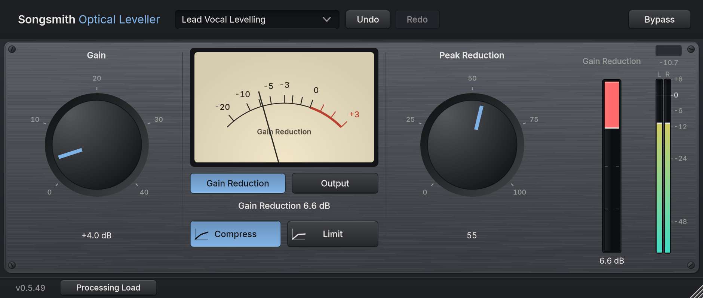
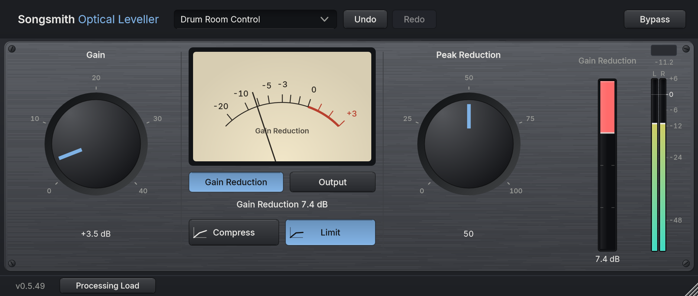
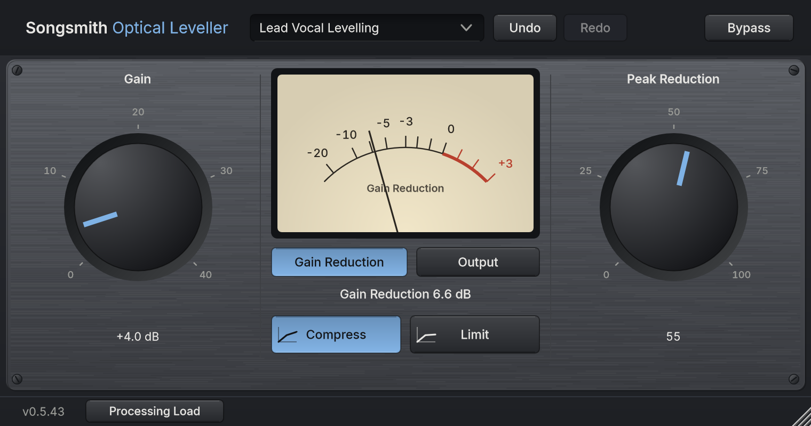

# Songsmith Optical Leveller

A smooth, simple optical leveller inspired by the Teletronix LA-2A, by Songsmith Studio, built with JUCE and CMake. It is an original design, not a clone, and isn't affiliated with or endorsed by Universal Audio. Every Songsmith plugin shares one version number: see the [changelog](../CHANGELOG.md).



*A real screenshot at 200 %, rendered by the test executable (`OpticalLevellerTests --screenshot <file> --scale 2`). The needle shows how much the level is being turned down.*



*The Drum Room Control starting point, which uses Limit.*

## What it does

It turns the loud parts of a sound down gently and evenly, so a vocal, a bass or a guitar stays at a steadier level. There are two knobs and a switch:

- **Peak Reduction** sets how much levelling you get. Turn it up and more of the louder sound is turned down.
- **Gain** sets the level after levelling. Turn it up to bring the sound back to the level it had before.
- **Compress or Limit** chooses gentle, smooth levelling (Compress) or firmer control of the loudest peaks (Limit).

At the far right, as in every Songsmith plugin, are the **Gain Reduction** bar and the **Output** meter (left and right channels, clip warning, held peak). Output is the sample peak after the leveller and Bypass, not true peak. The needle meter shows **Gain Reduction** (how much the level is being turned down) or **Output** (the level coming out, with 0 on the scale at -18 dBFS). Everything else is the same as the other Songsmith plugins: **Bypass** at the top right, **Undo** and **Redo**, a **Preset** menu, and **Processing Load** at the bottom left.

## What makes it "optical"

The original unit turns the level down with a light-sensitive part that lights up with the sound. Its timing is not fixed:

- It reacts in about 10 ms.
- When the sound drops, about half of the turning-down lets go in about 60 ms.
- The rest lets go more slowly, from about half a second up to about five seconds. The longer and harder the sound has pushed, the slower it lets go.

That "memory" is why it sounds smooth on a sung phrase and relaxed after a loud passage. Songsmith Optical Leveller models these behaviours and checks them with automated tests. The details, and what is published and what is a Songsmith design choice, are in [docs/engine.md](docs/engine.md).

It does not model the original's valves, transformers or noise, so it levels the sound without adding that colour.

## Presets

Four starting points, each named for what it is used for and level-matched at -18 dBFS so you compare the evenness and not the loudness: **Lead Vocal Levelling**, **Bass Guitar Levelling**, **Acoustic Guitar Smoothing** and **Drum Room Control**. Hover over the preset menu for a listening cue. **Save preset...** keeps your own as `.sspreset` files in `%APPDATA%\Songsmith Studio\Songsmith Optical Leveller\Presets` (Windows) or `~/Library/Songsmith Studio/Songsmith Optical Leveller/Presets` (macOS), and **Open presets folder** takes you there. Where each starting point comes from: [docs/presets.md](docs/presets.md).

## Good to know

- **Sessions and presets stay safe.** The parameter names, the plugin identity and the saved format never change for existing sessions.
- **No delay.** It adds no latency, so there is nothing to compensate for.
- **Stereo stays steady.** Both channels are turned down by the same amount, so the stereo image does not move.
- **Resizable.** Drag the bottom-right corner, from 75 % to 300 %. The size is saved with the session.
- **Status:** not yet verified in a real host, and no level-matched listening notes have been recorded. See [docs/presets.md](docs/presets.md#before-this-is-release-ready).

## Build and test

```powershell
cmake -S optical-leveller -B optical-leveller/build -G "Visual Studio 18 2026" -A x64 -DJUCE_DIR=C:/dev/JUCE
cmake --build optical-leveller/build --config Release
.\optical-leveller\build\OpticalLevellerTests_artefacts\Release\OpticalLevellerTests.exe
```

`OpticalLevellerTests` checks the engine ([docs/engine.md](docs/engine.md)), the plugin (identity, parameters, saved state, Bypass, presets, Undo and Redo) and the editor (layout at every size, plain wording, the shared Songsmith look), together with the shared Songsmith checks.


**SUI-23, before and after the far-right meters** (real screenshots at 200 %, rendered by the test executable):

| Before | After |
|---|---|
|  |  |
