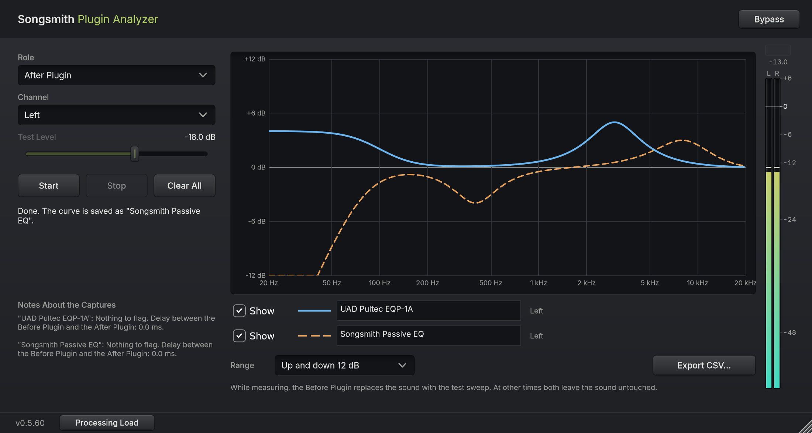
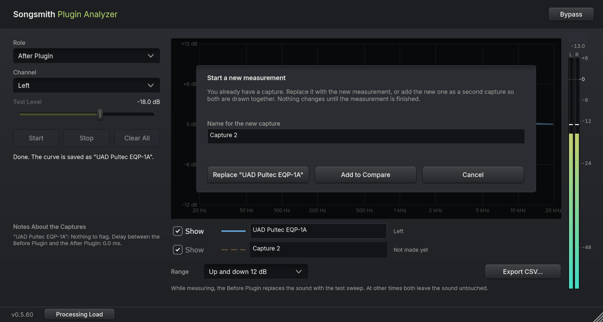
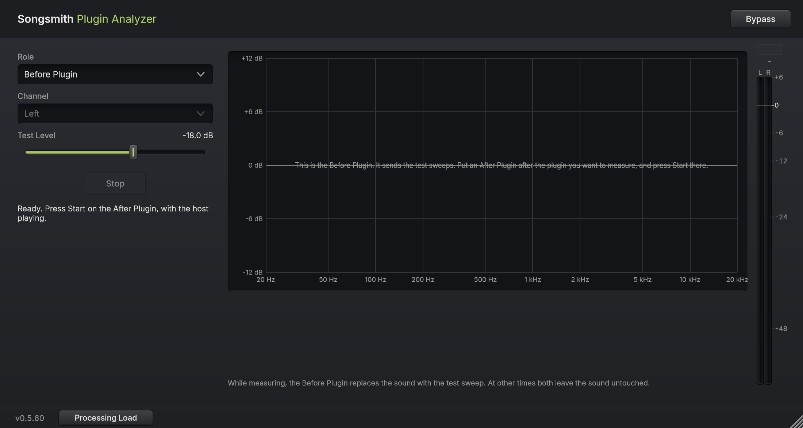
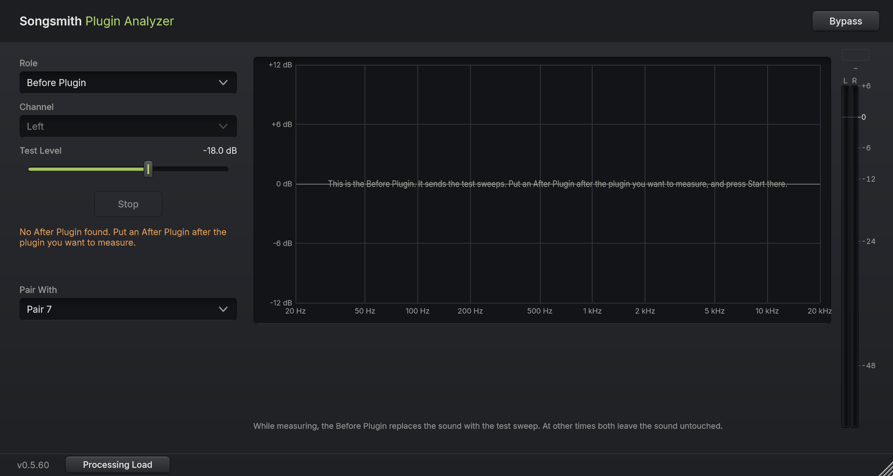
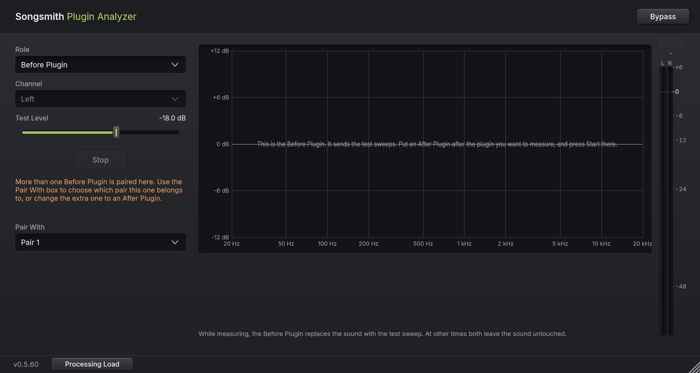

# Songsmith Plugin Analyzer

A VST3 plugin that **measures what another plugin does to the sound at each frequency**. Put one copy (the **Before Plugin**) before the plugin you want to measure and one copy (the **After Plugin**) after it. Press **Start** on the After Plugin while your recording software plays, and it draws the measured gain in decibels against frequency, from 20 Hz to 20 kHz. Make a second capture and both curves are drawn on the same graph.

Use it to check an equaliser's curve, to compare a hardware-inspired plugin with a Songsmith plugin, or to keep a record of a curve you want to match. It is a measuring tool, not an effect: it leaves the sound untouched except while a measurement is running.



*Real screenshots at 200 %, rendered by the test executable (`PluginAnalyzerTests --screenshot <file> --scale 2 --state curve|choice|pair|reference|problem`). The curves are made by test filters, not by a real plugin.*

## Using it

1. Put **Songsmith Plugin Analyzer** on the track **before** the plugin you want to measure. Set **Role** to **Before Plugin**.
2. Put a second copy **after** that plugin. Set **Role** to **After Plugin**. The two find each other on their own: there is no session or slot to choose.
3. Turn off anything in the chain that changes with level (a compressor stage, saturation, an automatic gain), so you measure the equaliser curve alone.
4. Start playback in your recording software, then press **Start** on the After Plugin. It takes about a quarter of a minute: two test sweeps, then the end of each. The curve is saved as **Capture 1**, and you can rename it.
5. To compare, change what is in the chain (for example bypass one equaliser and switch on another) and press **Start** again. It asks whether to **Replace** your capture or **Add to Compare**. Choose **Add to Compare**, and the second curve appears on the same graph, solid blue and dashed orange. Nothing is changed until the new measurement has finished, and your capture is never replaced without you choosing it.
6. Under the graph, each capture has a **Show** switch (hiding a capture does not delete it) and a name you can change at any time. **Export CSV...** saves the captures as a table. **Clear All** removes both, and asks first.



While measuring, the Before Plugin replaces the sound on that track with the test sweep. At other times both copies pass the sound through untouched, and they add no delay.





## The controls

| Control | What it does |
|---|---|
| **Role** | **Before Plugin** sends the test sweep. **After Plugin** records what arrives, draws the curve and keeps the captures. |
| **Pair With** | Not shown normally. It appears only when the two plugins cannot tell which pair they belong to (for example a project with several pairs, or two Before Plugins in one pair), so you can choose the same pair on both. |
| **Channel** | Which channel the After Plugin measures: Left, Right, or Both Combined. |
| **Test Level** | How loud the sweep is (−36 to −6 dB). Quieter is gentler on the plugin; louder keeps noise out of the curve. The default is −18 dB. Set it on the Before Plugin, which sends the sweep. |
| **Start**, **Stop**, **Clear All** | Start is on the After Plugin. Stop ends a measurement early and keeps your captures. Clear All empties both captures, after asking. |
| **Show**, **name** (one row for each capture) | Show or hide a capture on the graph, and give it a name that appears on the graph and in the CSV file. |
| **Range** | How many decibels the graph shows above and below 0 dB. |
| **Export CSV...** | Saves the captures as a table: frequency in hertz, then one column of decibels per capture, with notes about each at the top. |
| **Bypass** | Nothing is measured and the sound passes through untouched. |



The Output meter at the right shows the sweep leaving the Before Plugin, and what arrives at the After Plugin. If its clip warning lights during a measurement, lower **Test Level**.

### How the plugins find each other

A new plugin takes the first free pair, and when you change its Role it joins the other half that is waiting alone, so a Before Plugin and an After Plugin pair up with nothing to set. A second pair in the same project gets its own, the same way. A project you open again keeps the pairing it was saved with. If a project has more than eight pairs, or the plugins cannot tell, the **Pair With** box appears. Behind the scenes there are still eight numbered pairs, and the saved setting is still called Session, so existing projects open as they did.

## What it measures, and what it cannot

- It measures the **size of the response** (the gain at each frequency), not the phase. The curve is smoothed to a sixth of an octave.
- It lines up the Before Plugin and the After Plugin in time first, so a plugin's delay does not matter. It reports the delay it found.
- A **fixed equaliser** is measured accurately. In the tests, known filters (flat gain, high-pass, bell boost and cut, low shelf) read within 0.5 dB from 30 Hz to 18 kHz, at several block sizes and sample rates, and with noise at −70 dBFS in the path.
- A **compressor, saturation or anything that changes with level** is measured at the test level only. The curve is shown, but it is not a fixed curve for that plugin.
- It never claims what it cannot know. It says so, and shows no curve, when nothing arrived, the sweep arrived very quietly, the sound reached the top of the scale, the processing changed between the two sweeps, or the sound could not be lined up with the sweep.
- It does not match a hardware unit from knob positions, and it does not host other plugins itself.

## Limits

- Both copies must be loaded **in the same program**. Some recording software loads each plugin in its own separate process; there the After Plugin never finds a Before Plugin, and says so.
- It is a VST3 plugin only. It has no Audio Unit and no standalone app, because it needs two copies inside a host.
- There are **two captures** to compare, not more. A project saved with the earlier four named slots opens with its first two filled slots as the two captures.
- It has been tested with a simulated host (a Before Plugin and an After Plugin processing blocks of 64 to 4,096 samples, with delay). **Not yet verified in a DAW**, and in particular not yet tried in Studio One with a UAD plugin in the chain.

## Saving

The Role, Pair, Channel, Test Level and Bypass settings, the two captures with their names and whether each is shown, and the measured curves are saved with your project. Captures are restored when you reopen it, so you can keep a measurement for later without exporting it. A project saved by an earlier version (with four slots) opens with its filled slots as the two captures.

## Building and testing

```powershell
cmake -S plugin-analyzer -B plugin-analyzer/build -G "Visual Studio 18 2026" -A x64 -DJUCE_DIR=C:/dev/JUCE
cmake --build plugin-analyzer/build --config Release
.\plugin-analyzer\build\PluginAnalyzerTests_artefacts\Release\PluginAnalyzerTests.exe
```

It is part of the Songsmith Plugins installers on Windows and macOS, as its own tick box. Its parameter IDs, plugin code (`Anl1`), manufacturer code and package identifiers must never change, so saved projects keep loading.
