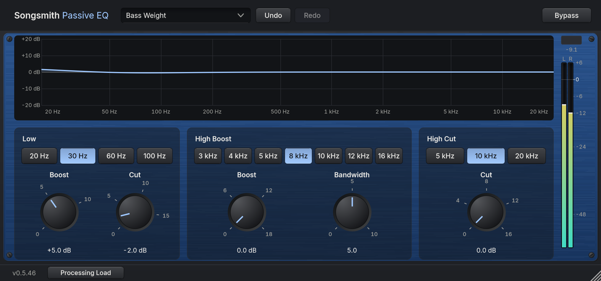
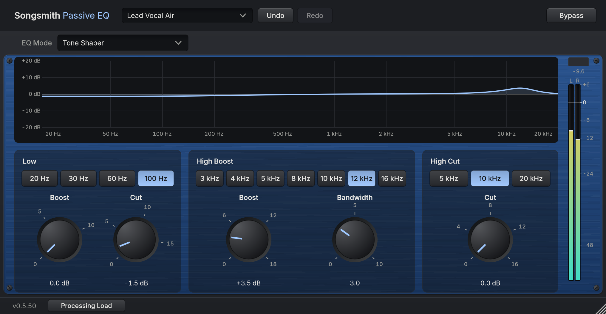
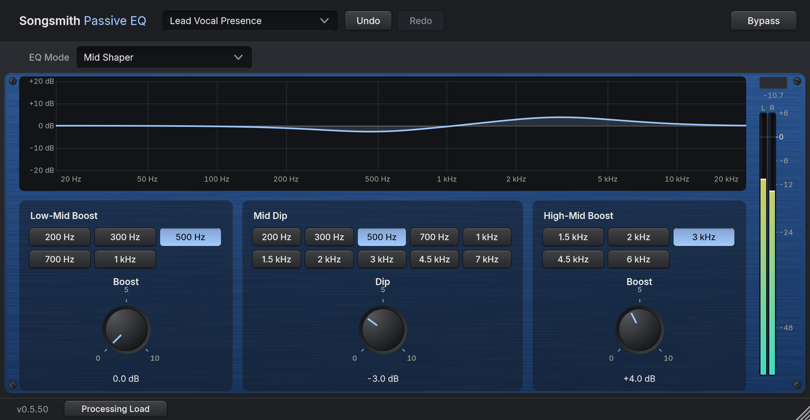
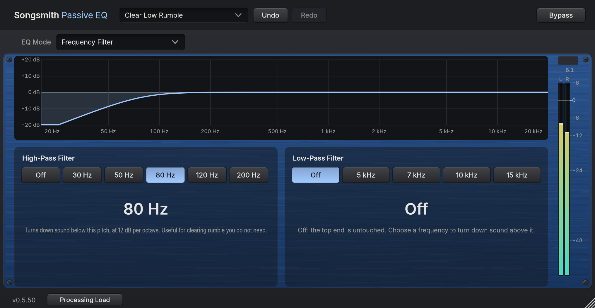
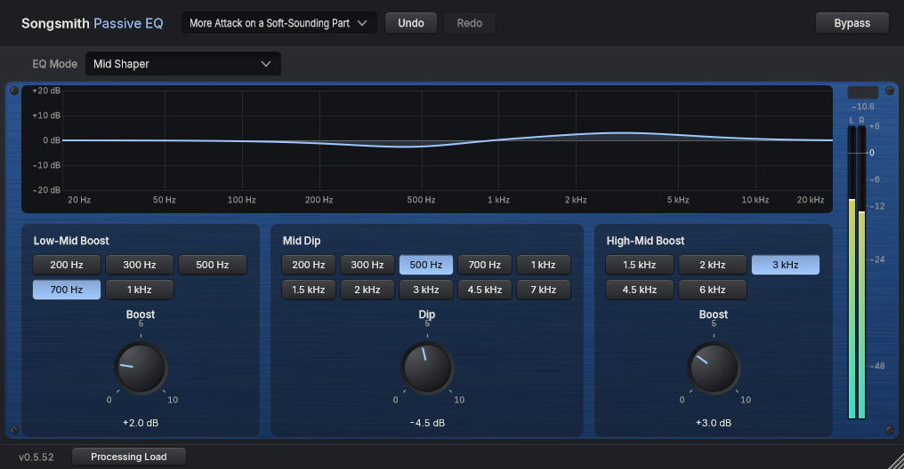
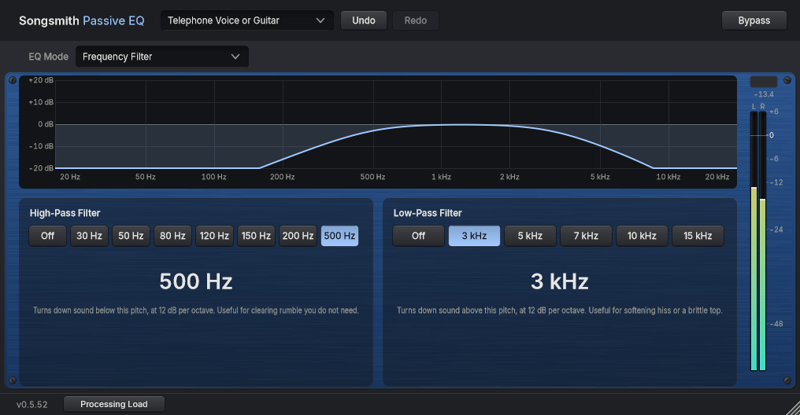

# Songsmith Passive EQ

A gentle tone equaliser inspired by the Pultec EQP-1A, by Songsmith Studio, built with JUCE and CMake. It is an original design, not a clone, and isn't affiliated with or endorsed by Pultec or Universal Audio. Every Songsmith plugin shares one version number: see the [changelog](../CHANGELOG.md).


*A real screenshot at 200 %, rendered by the test executable (`PassiveEQTests --screenshot <file> --scale 2 --preset 2`). The curve is the response of the filters the sound actually goes through.*



*The Bass Weight starting point: a low boost and a low cut at 30 Hz together.*

## Three modes

One **EQ Mode** dropdown, in a row of its own under the title bar (outside the blue panel, as in the Songsmith Analog Compressor), chooses what the equaliser does. The graph, the output meters, the preset menu, Undo and Redo, Bypass and Processing Load stay the same; only the controls in the blue panel change.

| Mode | What it does | Controls |
|---|---|---|
| **Tone Shaper** (the default, and what every earlier session is) | Broad, gentle low and high shaping, inspired by the Pultec EQP-1A | Low frequency, Boost and Cut; High Boost frequency, Boost and Bandwidth; High Cut frequency and Cut |
| **Mid Shaper** | Broad midrange shaping, inspired by the Pultec MEQ-5 | Low-Mid Boost, Mid Dip and High-Mid Boost, each with its own frequency switch (5, 10 and 5 positions) and an amount from 0 to 10 dB |
| **Frequency Filter** | A high-pass and a low-pass filter, inspired by the Pultec HLF-3C | High-Pass: Off, 30, 50, 80, 120, 150, 200 or 500 Hz. Low-Pass: Off, 3, 5, 7, 10 or 15 kHz. Each is one 12 dB per octave filter |

Each mode keeps its own settings, so you can switch back and forth without losing anything. Changing the mode while sound plays is blended over 20 milliseconds, so it does not click. These are Songsmith designs inspired by the classic units, not measured copies, and the Mid Shaper and Frequency Filter steps are Songsmith choices (see [docs/reference.md](docs/reference.md)). **Sessions and presets saved before the modes existed open as Tone Shaper and sound exactly as they did.**







*Real screenshots at 200 %, rendered by the test executable (`PassiveEQTests --screenshot <file> --scale 2 --preset 2`, `6` and `8`). The curve is the response of the filters the sound actually goes through.*





*Two of the nine PEQ-05 starting points, real screenshots at 100 % (`PassiveEQTests --screenshot <file> --preset 15` and `18`).*

## What Tone Shaper does

It lifts or lowers the low end and the high end in broad, gentle strokes. The controls are in three groups, each with its own frequency switch above its knobs:

- **Low** chooses a frequency (20, 30, 60 or 100 Hz). **Boost** adds weight below it. **Cut** turns the low end down a little higher up. Using both at the same frequency adds weight while keeping the low end tidy.
- **High Boost** chooses a frequency (3, 4, 5, 8, 10, 12 or 16 kHz). **Boost** lifts the top end around it, and **Bandwidth** sets how wide the lift is, from broad to narrow.
- **High Cut** chooses a frequency (5, 10 or 20 kHz). **Cut** turns everything above it down.

The curve at the top shows the combined effect, from 20 Hz to 20 kHz. The **Output** panel on the right holds the two tall meters, which show the output level of the left and right channels in dBFS, a compact **Output Trim** knob under them, and an **Auto Gain** button beside it. Like the hardware it is modelled on, a boost makes the sound louder. If you want to judge the sound rather than the volume, switch on **Auto Gain**: it compares the loudness going in with the loudness coming out and corrects the difference by up to 12 dB either way. **Output Trim** is applied after it, so your own setting always has the last word. Both start at 0 dB and off, so a session saved before they existed sounds exactly as it did. If the CLIP warning lights, lower the boosts or the Output Trim. It measures sample peak, not true peak. Everything else is the same as the other Songsmith plugins: **Bypass** at the top right, **Undo** and **Redo**, a **Preset** menu, and **Processing Load** at the bottom left.


*Real screenshot at 200 %, with a steady tone playing through it.*

A new instance does nothing: every amount starts at zero, and the sound passes through exactly as it came in.

## Where the numbers come from

The frequencies and the largest amounts (13.5 dB low boost, 17.5 dB low cut, 18 dB high boost and 16 dB high cut) are the values printed on the hardware's panel. The filter shapes, the width of the high boost and the relationship between the low boost and low cut are Songsmith design choices, checked by automated tests. [docs/reference.md](docs/reference.md) lists which is which, with the source and the test for each.

It does not model the original's valves or transformers, so it shapes the tone without adding that colour. It also does not add the original's small level change, so with everything at zero the level is untouched.

## Presets

Nineteen starting points, each named for what it is used for. Nine are Tone Shaper: **Bass Weight**, **Kick Drum Weight**, **Lead Vocal Air**, **Acoustic Guitar Brightness**, **Mix Bus Polish**, **Soften Harsh Highs**, **Punchy Kick**, **Deep, Tight Bass** and **Mix Bus Air**. Five are Mid Shaper: **Lead Vocal Presence**, **Reduce Boxy Mids**, **Bass Definition**, **Clear Lead Vocal** and **More Attack on a Soft-Sounding Part**. Five are Frequency Filter: **Clear Low Rumble**, **Soften Top Hiss**, **Rumble Cleanup**, **Tighter Rhythm Guitar** and **Telephone Voice or Guitar**. Choosing one also selects its mode. In the **Preset** menu they are grouped under headings you cannot choose, so you can find the right one quickly: **Drums**, **Bass**, **Guitar**, **Vocals**, **Mix Bus and Mastering** and **Utility** (see below), then **Your presets** if you have saved any. The arrow keys step from one starting point to the next and skip the headings. There is no output level control, so every boost also makes the sound louder: compare with the plugin switched in and out at the same listening level. Hover over the preset menu for a listening cue. **Save preset...** keeps your own as `.sspreset` files in `%APPDATA%\Songsmith Studio\Songsmith Passive EQ\Presets` (Windows) or `~/Library/Songsmith Studio/Songsmith Passive EQ/Presets` (macOS), and **Open presets folder** takes you there. Where each starting point comes from: [docs/presets.md](docs/presets.md).

The **Preset** menu, as it is laid out (the headings are not choices):

```
Drums                    Guitar                       Mix Bus and Mastering
  Punchy Kick              Acoustic Guitar Brightness   Mix Bus Air
  Kick Drum Weight         Tighter Rhythm Guitar        Mix Bus Polish
Bass                     Vocals                       Utility
  Deep, Tight Bass         Clear Lead Vocal             Rumble Cleanup
  Bass Weight              Lead Vocal Presence          Clear Low Rumble
  Bass Definition          Lead Vocal Air               Reduce Boxy Mids
                           Telephone Voice or Guitar    Soften Harsh Highs
                                                        Soften Top Hiss
                                                        More Attack on a Soft-Sounding Part
Your presets (only if you have saved some)
```

*That is a text outline, not a screenshot: the open menu is a separate pop-up window that the test program's screenshots do not capture.* A starting point sits in one group only, even when it could suit two: **Telephone Voice or Guitar** is under Vocals, and **More Attack on a Soft-Sounding Part** under Utility because it is not tied to one instrument. **Punchy Kick** is the classic low-end trick (a Low Boost and a Low Cut together at 60 Hz); there is no second copy under another name.

## Good to know

- **Sessions and presets stay safe.** The parameter names, the plugin identity and the saved format never change for existing sessions. The modes added new parameters (every amount at zero, every filter Off, the mode on Tone Shaper), so an older session or preset file loads as Tone Shaper with the sound it always had. A preset saved now stores the mode and every mode's settings.
- **No delay.** It adds no latency, so there is nothing to compensate for.
- **Switching a frequency does not click.** The old and new filters are blended over 20 milliseconds.
- **Resizable.** Drag the bottom-right corner, from 75 % to 300 %. The size is saved with the session.
- **Status:** not yet verified in a real host, no level-matched listening notes have been recorded, and Joe Gilder's tone-shaping tutorials have not been reviewed. See [docs/presets.md](docs/presets.md#before-this-is-release-ready).

## Build and test

```powershell
cmake -S pultec-eq -B pultec-eq/build -G "Visual Studio 18 2026" -A x64 -DJUCE_DIR=C:/dev/JUCE
cmake --build pultec-eq/build --config Release
.\pultec-eq\build\PassiveEQTests_artefacts\Release\PassiveEQTests.exe
```

`PassiveEQTests` checks the engine ([docs/reference.md](docs/reference.md)), the plugin (identity, parameters, saved state, Bypass, presets, Undo and Redo) and the editor (layout at every size, plain wording, the response curve, the shared Songsmith look), together with the shared Songsmith checks.
