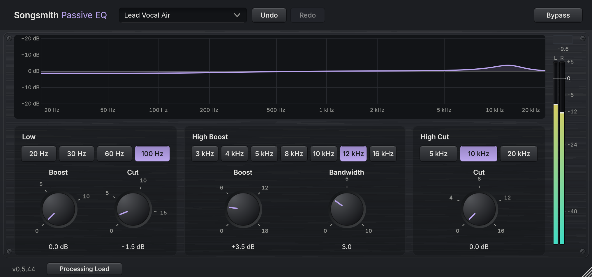

# Songsmith Passive EQ

A gentle tone equaliser inspired by the Pultec EQP-1A, by Songsmith Studio, built with JUCE and CMake. It is an original design, not a clone, and isn't affiliated with or endorsed by Pultec or Universal Audio. Every Songsmith plugin shares one version number: see the [changelog](../CHANGELOG.md).


*A real screenshot at 200 %, rendered by the test executable (`PassiveEQTests --screenshot <file> --scale 2 --preset 2`). The curve is the response of the filters the sound actually goes through.*


*The Bass Weight starting point: a low boost and a low cut at 30 Hz together.*

## What it does

It lifts or lowers the low end and the high end in broad, gentle strokes. The controls are in three groups, each with its own frequency switch above its knobs:

- **Low** chooses a frequency (20, 30, 60 or 100 Hz). **Boost** adds weight below it. **Cut** turns the low end down a little higher up. Using both at the same frequency adds weight while keeping the low end tidy.
- **High Boost** chooses a frequency (3, 4, 5, 8, 10, 12 or 16 kHz). **Boost** lifts the top end around it, and **Bandwidth** sets how wide the lift is, from broad to narrow.
- **High Cut** chooses a frequency (5, 10 or 20 kHz). **Cut** turns everything above it down.

The curve at the top shows the combined effect, from 20 Hz to 20 kHz. The two tall meters on the right show the output level of the left and right channels, after the filters and Bypass, in dBFS. There is no output level control, so a boost makes the sound louder: if the CLIP warning lights, lower the boosts. It measures sample peak, not true peak. Everything else is the same as the other Songsmith plugins: **Bypass** at the top right, **Undo** and **Redo**, a **Preset** menu, and **Processing Load** at the bottom left.



*Real screenshot at 200 %, with a steady tone playing through it.*

A new instance does nothing: every amount starts at zero, and the sound passes through exactly as it came in.

## Where the numbers come from

The frequencies and the largest amounts (13.5 dB low boost, 17.5 dB low cut, 18 dB high boost and 16 dB high cut) are the values printed on the hardware's panel. The filter shapes, the width of the high boost and the relationship between the low boost and low cut are Songsmith design choices, checked by automated tests. [docs/reference.md](docs/reference.md) lists which is which, with the source and the test for each.

It does not model the original's valves or transformers, so it shapes the tone without adding that colour. It also does not add the original's small level change, so with everything at zero the level is untouched.

## Presets

Six starting points, each named for what it is used for: **Bass Weight**, **Kick Drum Weight**, **Lead Vocal Air**, **Acoustic Guitar Brightness**, **Mix Bus Polish** and **Soften Harsh Highs**. There is no output level control, so every boost also makes the sound louder: compare with the plugin switched in and out at the same listening level. Hover over the preset menu for a listening cue. **Save preset...** keeps your own as `.sspreset` files in `%APPDATA%\Songsmith Studio\Songsmith Passive EQ\Presets` (Windows) or `~/Library/Songsmith Studio/Songsmith Passive EQ/Presets` (macOS), and **Open presets folder** takes you there. Where each starting point comes from: [docs/presets.md](docs/presets.md).

## Good to know

- **Sessions and presets stay safe.** The parameter names, the plugin identity and the saved format never change for existing sessions.
- **No delay.** It adds no latency, so there is nothing to compensate for.
- **Switching a frequency does not click.** The old and new filters are blended over 20 milliseconds.
- **Resizable.** Drag the bottom-right corner, from 75 % to 300 %. The size is saved with the session.
- **Status:** not yet verified in a real host, no level-matched listening notes have been recorded, and Joe Gilder's tone-shaping tutorials have not been reviewed. See [docs/presets.md](docs/presets.md#before-this-is-release-ready).

## Build and test

```powershell
cmake -S pultec-eq -B pultec-eq/build -G "Visual Studio 18 2026" -A x64 -DJUCE_DIR=C:/dev/JUCE
cmake --build pultec-eq/build --config Release
.\pultec-eq\build\PassiveEQTests_artefacts\Release\PassiveEQTests.exe
```

`PassiveEQTests` checks the engine ([docs/reference.md](docs/reference.md)), the plugin (identity, parameters, saved state, Bypass, presets, Undo and Redo) and the editor (layout at every size, plain wording, the response curve, the shared Songsmith look), together with the shared Songsmith checks.
