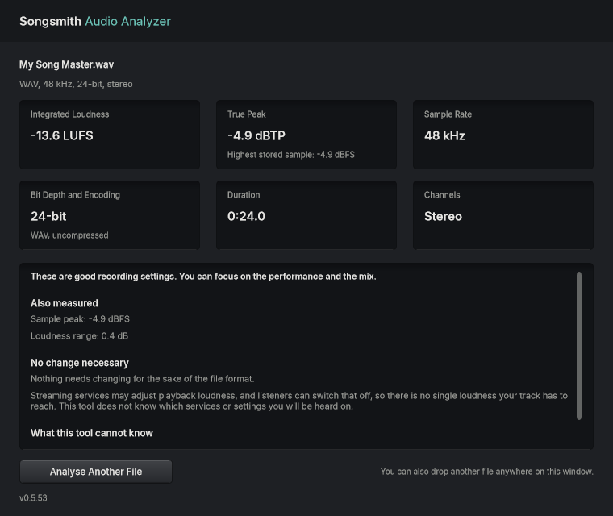

# Recording and Streaming Advisor (REC-01)

Whole-file, analysis-only advice for the standalone Songsmith Loudness Analyser: drag in a finished track and see its format and loudness in plain words. It never remasters, resamples, converts or overwrites anything, and it never reads a file inside a plugin's real-time audio callback.

**Status:** the analysis core, the advice wording and the tests are in place, and since REC-02 the standalone app is built on them: [Songsmith Audio Analyzer](../../audio-analyzer/README.md) (`audio-analyzer/`), with its own window, installers and tests. The shared tests now run inside `AudioAnalyzerTests`. Nothing here is visible in any plugin.

| Part | File |
|---|---|
| Reading and measuring a file | `shared/Source/SongsmithFileAnalysis.h` |
| Turning measurements into advice | `shared/Source/SongsmithFileAdvice.h` |
| Tests | `shared/Tests/SongsmithFileAdvisorTests.h` |

## Supported files

WAV, AIFF and FLAC, read through JUCE's format readers (`registerBasicFormats`). Other files (MP3 and so on) are refused with a plain message, not guessed at. FLAC support depends on JUCE's bundled FLAC reader being enabled in the build, which is the JUCE default.

## What is a real measurement

| Reading | How |
|---|---|
| Format, sample rate, channels, stored bit depth, integer or floating point, length | Read from the file's own header. |
| Integrated loudness (LUFS) | ITU-R BS.1770-4 K-weighting (the shared `SongsmithKWeighting.h`, also used by the Maximiser's meter and Songsmith EQ), 400 ms windows every 100 ms, absolute gate -70 LUFS, relative gate 10 dB below. Not shown for files shorter than 400 ms or quieter than the gate. |
| Loudness range | EBU Tech 3342 style: 3 s windows, relative gate 20 dB below, 10th to 95th percentile. Not shown for files shorter than 3 s of gated sound. |
| Sample peak | The largest sample value, in dBFS. |
| Maximum true peak | 4x (2x from 96 kHz) Kaiser-windowed sinc interpolation, in dBTP. This is a separate design from the Maximiser's limiter detector (8x, 24 taps), so the tests check it against known signals rather than against the limiter. |
| Runs at the ceiling | Three or more samples in a row at the highest value the file can store. |
| Bits in use | For integer files: if the lowest bits are zero in every sample, the values fit in fewer bits than stored. |

Six-channel files use the BS.1770 weights (surrounds 1.41, low-frequency channel left out). Other layouts weight every channel equally, which is only an estimate for unusual layouts.

## What is an estimate or a listening suggestion

- Any statement about loudness, such as "a very loud track is turned down where playback is levelled", is general and conditional. The -9 LUFS and -24 LUFS points that choose which note to show are Songsmith design choices, not standards.
- Clipping: runs at the ceiling are described as possibly deliberate. A flat top does not prove the original capture clipped.
- The peak suggestion of -12 to -6 dBFS for the next recording is a common, cautious habit, not a requirement.

## What the tool cannot know

- The settings the sound was first recorded at. A 24-bit file can hold audio that began at 16-bit, and a music program processes at 32-bit floating point internally; "bits in use" only shows what the file's values allow.
- Which services or playback settings the listener uses. No platform-specific loudness claim is made, because none is backed here by a dated official source. If one is added later it needs the source and its date, and wording that depends on the listener's setting.
- Whether a flat-topped waveform came from recording, mixing or mastering.

## Advice rules

Each message says what matters, why, and whether the musician needs to do anything. Next steps are grouped as **No change necessary**, **Try this if you're hearing a problem** and **For your next recording**. There are no scores, pass or fail marks or alarm badges. 44.1 kHz and 16-bit are described as CD quality and fine; 24-bit is described as extra flexibility with levels for the next recording, never as repairing an existing file, and nothing suggests converting 16-bit to 24-bit.

The wording test (`Songsmith::UI::Wording::findBanned`) runs on every message. `WAV`, `AIFF`, `FLAC` and `CD` were added to its allowed short forms for this feature; the list in `docs/style-guide.md#wording` needs the same four words added (outside the folders this change could edit).

## Tests

`SongsmithFileAdvisorTests` writes real files to a temporary folder and reads them back: 44.1 kHz 16-bit and 24-bit, 48 kHz 24-bit, AIFF, FLAC, 32-bit floating point, a sine at -23 dBFS reading -23 LUFS (EBU Tech 3341 level case), a true peak between samples, clipping, silence, very short and very quiet files, gating, loudness range, a very loud file, a 24-bit file holding 16-bit values, damaged, cut-short, missing and unsupported files, unchanged original bytes, and cancellation.

**Not yet verified:** the tests have not been compiled or run by the author of this change (no build was possible in this session); the hosted build is the first run. They have not been compared against third-party reference WAV files (for example the EBU Tech 3341 and 3342 test set), which should be added to confirm the loudness range and gating beyond the generated signals.
